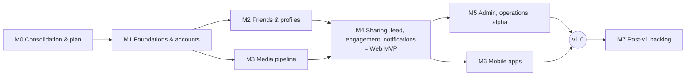

# VidFriends Roadmap (canonical)

> **This is the single authoritative plan** for scope, priorities, dependencies, sequencing and completion criteria ([ADR-0001](adr/0001-record-architecture-decisions.md)). It links to the specifications rather than restating them. If another document disagrees with this one about *what* is planned or *when*, this document wins. Requirement wording belongs to the [SRS](requirements/SRS.md).

- **Last updated:** 2026-10-03
- **Status legend:** ✅ done (with evidence) · 🟡 partial · ⬜ planned · ⛔ blocked · 💤 deferred

## 1. Product summary

**VidFriends is a private "For You" page made only of videos your friends sent you.**
- **Users:** small, trusted circles of friends and family, who join an instance run by someone they trust.
- **Outcomes:** see [BRD §3](requirements/BRD.md#3-business-outcomes) (BO-1..BO-6).
- **Scope and non-goals:** see [PRD §3 and §5](requirements/PRD.md).

**In v1:**
- Invite-only instances
- Consent-based friends
- Adding videos by link or upload, with the server fetching and hosting the media
- Sending to specific friends
- A vertical feed of received videos
- Private reactions and replies
- Notifications
- An admin console
- Web/PWA, then iOS and Android via Expo

**Not in v1:**
- Public or social-network features
- Recommendations
- Federation
- Playlist import
- Collections
- Passkeys and offline downloads (backlog)

## 2. Current state → target state

| | Current (2026-10-03, evidence) | Target (end of M6) |
|---|---|---|
| Code | **None.** All seven legacy repos were consolidated here. Code was removed after the tag `legacy-code-snapshot` ([ADR-0002](adr/0002-consolidate-repos-and-greenfield-reset.md)). | Monorepo per [ADR-0012](adr/0012-monorepo-and-tooling.md) with server, worker, web and mobile apps |
| Working features | None. No legacy attempt worked end to end ([AUDIT §2](legacy/AUDIT.md#2-what-each-attempt-contributes)). | All Must requirements in the SRS verified |
| Specs | This document set (Draft v1) | Maintained alongside code |
| Tests / CI | None | CI gate per NFR-MAINT-02; E2E for J-1..J-8 |
| Deployments | Unknown legacy deployments may exist (see M0-T3) | v1 released as self-hostable software; the owner's private instance runs it; operators have a runbook |

## 3. Constraints, decisions, assumptions, open questions

### 3.1 Confirmed constraints
BC-1..BC-7 in the [BRD](requirements/BRD.md#5-business-constraints): no ads or telemetry, low cost, a private circle, agent-driven delivery, legal care with downloads, self-hostability, app-store accounts.

### 3.2 Decisions

| Decision | Who | Record |
|---|---|---|
| Consolidate all restarts into this repo; remove code; greenfield | **Owner** | [ADR-0002](adr/0002-consolidate-repos-and-greenfield-reset.md) |
| Web stack: React, Vite, TS, Tailwind, shadcn/ui, Radix, TanStack Query and Router | **Owner** | [ADR-0003](adr/0003-web-client-stack.md) |
| Mobile via Expo instead of native apps | **Owner** (accepted Claude's recommendation) | [ADR-0004](adr/0004-mobile-expo.md) |
| Document-set governance | Claude (delegated) | [ADR-0001](adr/0001-record-architecture-decisions.md) |
| Single-tenant, self-hostable, invite-only instances | Claude (delegated); default-instance clause superseded by ADR-0014 | [ADR-0005](adr/0005-instance-model.md) |
| Zod contracts → OpenAPI; snake_case JSON; `/api/v1` | Claude (delegated) | [ADR-0006](adr/0006-api-contract-first.md) |
| Backend: Node + Hono + Postgres + Drizzle + pg-boss; separate worker | Claude (delegated) | [ADR-0007](adr/0007-backend-stack.md) |
| Opaque DB sessions (cookie for web, bearer for mobile) | Claude (delegated) | [ADR-0008](adr/0008-authentication-sessions.md) |
| Download and host media through durable jobs; private S3 with presigned URLs | Claude (delegated); legal risk **accepted by owner** (OQ-1) | [ADR-0009](adr/0009-media-ingestion-and-storage.md) |
| Share-centric model; private conversations; no global feed | Claude (delegated) | [ADR-0010](adr/0010-share-centric-social-model.md) |
| In-app + Web Push + Expo Push; polling, no realtime | Claude (delegated) | [ADR-0011](adr/0011-notifications.md) |
| pnpm + Turborepo monorepo layout | Claude (delegated) | [ADR-0012](adr/0012-monorepo-and-tooling.md) |
| Bundle SeaweedFS instead of MinIO (MinIO images no longer pullable); serve `/media-store/*` unrewritten | Claude (delegated), 2026-10-04 | [ADR-0015](adr/0015-bundled-object-store-seaweedfs.md) |
| HTTPS join links; QR encodes the same URL | Claude (delegated); amended by ADR-0014 | [ADR-0013](adr/0013-instance-pairing-and-join-links.md) |
| Self-host only: no public or default instance, no project domain; licence MIT; name VidFriends | **Owner** (2026-10-03) | [ADR-0014](adr/0014-self-host-only-no-public-instance.md), [BRD §7](requirements/BRD.md#7-open-questions-all-resolved-2026-10-03) |

### 3.3 Assumptions (owner may overturn)

The numbering is kept stable. A-1 (licence) and A-4 (default instance) were resolved by the owner on 2026-10-03 and removed.

- **A-2:** No email is collected; password recovery is admin-assisted (BR-ACCT-4).
- **A-3:** Scale is ≤ 50 users per instance. All performance numbers marked † are proposals.
- **A-5:** Expo push relay is acceptable (BC-6 exception).

### 3.4 Open questions
**None open.** The owner resolved OQ-1..OQ-4 on 2026-10-03 ([BRD §7](requirements/BRD.md#7-open-questions-all-resolved-2026-10-03)):
- Download risk accepted for private groups.
- Licence is MIT.
- Name is VidFriends, with no project domain.
- There will be no public server ([ADR-0014](adr/0014-self-host-only-no-public-instance.md)).

### 3.5 Resolved conflicts between legacy sources

| Conflict | Resolution |
|---|---|
| Hosted service (2025) vs self-hosted (2026) | ADR-0005 |
| Broadcast vs per-recipient sends | ADR-0010 |
| Read/unread vs accept/reject inbox | Neither. The Share has watched, saved and hidden state (FRD §6–7). |
| Public likes and comments vs per-share reactions | ADR-0010 |
| Email vs username identity | Username, no email (BR-ACCT-1/4) |
| Go vs TS backend | ADR-0007 |

## 4. Documentation map

| Path | Purpose | Status | Authoritative for |
|---|---|---|---|
| [`AGENTS.md`](../AGENTS.md) | How agents work in this repo | Current | Process rules |
| `docs/ROADMAP.md` (this) | Plan and status | Current | Scope, priority, sequencing, completion |
| [`docs/requirements/BRD.md`](requirements/BRD.md) | Business requirements | Draft v1 | Outcomes BO-*, constraints BC-*, open questions |
| [`docs/requirements/PRD.md`](requirements/PRD.md) | Product requirements | Draft v1 | Personas, capabilities CAP-*, journeys J-*, non-goals |
| [`docs/requirements/FRD.md`](requirements/FRD.md) | Functional behaviour | Draft v1 | Workflows WF-*, rules BR-*, state machines, permissions |
| [`docs/requirements/SRS.md`](requirements/SRS.md) | Canonical requirements | Draft v1 | FR-*/NFR-* text, verification, traceability |
| [`docs/design/HLD.md`](design/HLD.md) | High-level design | Draft v1 | Components C-*, topology, trust boundaries, data flows |
| [`docs/design/SDD.md`](design/SDD.md) | Software design | Draft v1 | Module structure, authorization model, job semantics, client architecture |
| [`docs/design/TDD.md`](design/TDD.md) | Technical design | Draft v1 | Engineering choices, security engineering, deploy/ops, test strategy, migration |
| [`docs/design/LLD.md`](design/LLD.md) | Low-level design | Draft v1 | Schema, API outline, pipeline states, security mechanism parameters |
| [`docs/adr/`](adr/README.md) | Decision records 0001–0015 | Accepted | Architectural decisions |
| [`docs/legacy/AUDIT.md`](legacy/AUDIT.md) | Legacy findings and lessons L-* | Final | History only (not requirements) |
| [`docs/legacy/audits/`](legacy/audits/), [`docs/legacy/original-docs/`](legacy/original-docs/) | Raw audit evidence; verbatim legacy docs | Superseded / historical | Nothing (reference only) |

## 5. Milestones

M2 and M3 can run in parallel after M1. M5 and M6 can run in parallel after M4. No dates are committed. Sizing is relative: M1 L, M2 S, M3 L, M4 XL, M5 M, M6 L.

**Every milestone exit requires:**
1. All listed tasks are merged.
2. The listed E2E/API specs pass in CI on `main`.
3. The docs are updated (AGENTS.md rules).
4. The authorization matrix covers every new route.
5. The status in this file is updated, with links to the evidence (PRs, test paths).

---

### M0: Consolidation and plan ✅

| Task | Status | Evidence / completion check |
|---|---|---|
| M0-T1 Transfer `vidshare` and `vidfriends` into the `VidFriends` org | ✅ | `gh repo list VidFriends` shows both (2026-10-03) |
| M0-T2 Merge all seven histories into this repo, tag `legacy-code-snapshot`, remove code, write docs | ✅ | Tag `legacy-code-snapshot`; this document set; [ADR-0002](adr/0002-consolidate-repos-and-greenfield-reset.md) |
| M0-T3 **Owner:** decommission any running legacy deployment (2025 Worker, 2026 compose stacks) and never reuse the committed VAPID key ([AUDIT §5](legacy/AUDIT.md#5-security-follow-ups-that-apply-outside-this-repository)) | ✅ | Owner confirmed on 2026-10-04 (multiple-choice answer: "Yes, all shut down") that no legacy service is reachable and the old VAPID key is retired. |
| M0-T4 Archive the six superseded repos (`vidshare`, `vidfriends-backend`, `-web`, `-ios`, `-android`, `VidFriends-iOS-Android`); close the 35 obsolete Dependabot PRs; reduce this repo to the single branch `main` | ✅ | Done 2026-10-03 at the owner's request. `gh repo list VidFriends` shows all six `archived=true`; only `main` remains here. Human-authored PR vidfriends-android#2 was left open in the archive, and its work is tagged `legacy/vidfriends-android-2026/vid-503-fix`. | `gh repo view … --json isArchived` returns true for each |
| M0-T5 Owner answers OQ-1..OQ-4 and reviews provisional decisions | ✅ | BRD §7 answers; ADR-0014; ADR-0005/0009/0013 status lines updated |

### M1: Foundations and accounts 🟡 (in progress)

**Goal:** a walking skeleton. An operator deploys the stack locally, claims the instance, creates an invite, and a friend registers through the join link, logs in and logs out. CI enforces the full quality gate.

**Requirements:**
- FR-PAIR-01, 02, 04 (web); FR-AUTH-01..06; FR-ACCT-02; FR-INV-01..03; FR-ADM-05 (audit writes)
- NFR-SEC-01 (harness), 02, 03, 04, 06, 07; NFR-PRIV-01..03; NFR-REL-02, 03; NFR-OPS-02, 03 (logs and health); NFR-I18N-01; NFR-MAINT-01, 02

**Prerequisites:**
- None technical.
- The owner should enable branch protection on `main` when CI lands (M1-T2).

| Task | Objective | References | Depends on | Completion check |
|---|---|---|---|---|
| M1-T1 Monorepo scaffold | pnpm workspace + Turborepo; `apps/server`, `apps/web`, `packages/{contracts,api-client,config,test-utils}`; shared tsconfig, ESLint (jsx-a11y, import/no-cycle) and Prettier; MIT LICENSE (BRD OQ-2); root README dev instructions | ADR-0012, TDD §1 | – | `pnpm install && pnpm build && pnpm lint && pnpm typecheck` succeed locally and in CI |
| M1-T2 CI pipeline | GitHub Actions on PR and `main`: static, unit, contract, API integration (Postgres + SeaweedFS S3 services, ADR-0015), Playwright (Chromium), Docker build, Trivy (blocking on fixable criticals), migration-immutability check, Dependabot or Renovate config | NFR-MAINT-02, NFR-SEC-07, NFR-REL-03, TDD §7 | T1 | Workflow green on a PR; a deliberately failing test blocks merge |
| M1-T3 Contracts and OpenAPI | Error envelope, pagination schema, route-definition helper with `auth` level; `GET /instance`; OpenAPI generation script and CI drift check; typed client in `api-client` | ADR-0006, LLD §3, NFR-MAINT-01 | T1 | `pnpm --filter contracts gen` output is committed; CI fails when it is stale (verified by a test PR) |
| M1-T4 Server skeleton | Env config schema with secret checks; Hono app with the middleware chain from SDD §2 (request id, pino with redaction, security headers and CSP, IP rate limit, error mapper); `/healthz`, `/readyz`; SPA static serving with fallback; `ROLE` entrypoint; graceful shutdown | SDD §1–2, TDD §3, LLD §5, NFR-SEC-03/04/06, NFR-OPS-02/03, NFR-REL-02, NFR-PRIV-02 | T3 | Unit tests: config rejects default and short secrets; log redaction; API test: security headers present, `/readyz` fails when the DB is down |
| M1-T5 Database and migrations | Drizzle setup; migrate entrypoint; tables `users`, `sessions`, `invites`, `invite_redemptions`, `relationships` (for auto-friend), `instance_settings`, `audit_log`, `password_resets` | LLD §2, NFR-REL-03 | T4 | `migrate` applies to an empty DB in CI; migration checksum file present |
| M1-T6 Containers and compose | Multi-target Dockerfile (`server`; `worker` stub); `deploy/compose.dev.yml`; `deploy/compose.yml` (caddy, migrate, server, worker, postgres, seaweedfs per ADR-0015) and `.env.example` without working secrets | HLD §3, TDD §6 | T4, T5 | `docker compose -f deploy/compose.yml up` on a clean machine reaches `/readyz` = 200 behind Caddy (local TLS) |
| M1-T7 Authentication and sessions | Setup bootstrap; register (invite, auto-friend); login and logout (all); session middleware (cookie and bearer, idle and absolute expiry, status and role from DB); CSRF; password change; auth rate limits; audit entries | FRD §2–3, ADR-0008, LLD §3/§5, FR-AUTH-*, FR-ACCT-02 | T5 | API tests per FR-AUTH-01..06 including suspended-user rejection and concurrent invite consumption; unit tests for validation and password denylist |
| M1-T8 Invites | Create, list, revoke, preview; hashed codes; `members_can_invite` setting | FR-INV-01..03, BR-INV-* | T7 | API tests; code is returned only once; revoked or expired invites are rejected |
| M1-T9 Authorization-matrix harness | `test-utils` fixture world and matrix runner; CI fails for any id-bearing route not in the matrix | SDD §3, NFR-SEC-01 | T7 | Harness covers all M1 routes; meta-test proves an unlisted route fails CI |
| M1-T10 Web shell | Vite + TanStack Router/Query + Tailwind + shadcn/ui + i18n catalogs; routes `/setup`, `/login`, `/join/$code`, app layout with nav placeholders (only real routes are linked), `/settings` (password change, logout everywhere), `/invites` (create with join URL and QR, list, revoke); global 401 handling | ADR-0003, SDD §5, TDD §4, FR-PAIR-02/04, FR-INV-03 | T3, T7, T8 | Playwright specs below pass; axe reports no violations on these pages |
| M1-T11 E2E harness and acceptance | Playwright runs against the production image via compose; API-based seed helpers; specs `setup.spec.ts` (J-1: claim instance, create invite) and `join.spec.ts` (J-2: register through join URL, auto-friend relationship exists via API, logout, login) | TDD §7, NFR-MAINT-03 | T6, T10 | Both specs green in CI on `main` |

**Exit criteria:** every check above passes. A new agent can run `pnpm dev`, then `pnpm test`, then `pnpm e2e` by following the README.

### M2: Friends and profiles ⬜

**Goal:** members find each other and manage relationships.
**Requirements:** FR-ACCT-01; FR-FRND-01..05.
**Prerequisites:** M1.

| Task | Objective | References | Completion check |
|---|---|---|---|
| M2-T1 Relationship service | State machine with auto-accept, decline cooldown, block and unblock, rate limit | FRD §4, LLD §2 `relationships` | Table-driven API test covering every transition and every forbidden transition |
| M2-T2 Search and lists | `GET /users`, friends, requests (in and out), blocks | BR-FRND-8 | API tests, including block-aware exclusion; authz matrix updated |
| M2-T3 Object storage foundation | S3 client, presigned PUT/GET helpers, key scheme, SeaweedFS in the CI services | ADR-0009, ADR-0015, LLD §4 | API test: presign round-trip against SeaweedFS |
| M2-T4 Profile and avatar | Display name edit; avatar upload (presigned, re-encoded to 256 px WebP by an inline server step or a simple job) | FR-ACCT-01, BR-ACCT-3, NFR-SEC-08 | API test rejects a non-image disguised as an image |
| M2-T5 Friends UI | `/friends` (search, requests, friends, blocked) with optimistic actions and rollback | SDD §5, NFR-A11Y-01 | Playwright `friends.spec.ts`: request → accept → remove → block → unblock across two users |

**Exit:** M2-T5 spec green; FR-FRND state-machine test green.

### M3: Media pipeline ⬜

**Goal:** a member adds a video by link or upload and it becomes playable (or link-only) through durable jobs.
**Requirements:** FR-VID-01..05, 07, 09; NFR-SEC-05, 08; NFR-REL-01; NFR-PERF-03; NFR-OPS-05.
**Prerequisites:** M1, plus M2-T3 (storage). M3 can start with T1–T3 in parallel with M2.

| Task | Objective | References | Completion check |
|---|---|---|---|
| M3-T1 Job runtime | pg-boss setup, worker entrypoint, transactional enqueue helper, job conventions (idempotency, logging, metrics hooks) | SDD §4, ADR-0007 | Kill-and-restart API test: an enqueued job completes exactly once after a worker restart |
| M3-T2 URL validation and normalisation | Allowlist, SSRF guard (DNS + private ranges), normalisation rules, short-link resolution | BR-MED-1, LLD §4, NFR-SEC-05 | Unit test table of ≥ 40 URLs (valid, invalid, SSRF, tracking params) |
| M3-T3 `video.fetch` | yt-dlp runner (execFile, `--`, caps, temp directory cleanup), retries, link_only fallback, `link_download_enabled` | FR-VID-02, 09, TDD §2 | API tests using a **fake yt-dlp script** fixture covering success, oversize, timeout, failure → link_only; temp dir empty after each |
| M3-T4 `video.process` | ffprobe, remux or transcode, thumbnail, upload renditions, storage accounting | FR-VID-04, LLD §4 | Fixture media tests: H.264 MP4 (remux), HEVC MOV (transcode), corrupt file (failed) |
| M3-T5 Uploads | Presigned (multipart) upload, complete, sniff, hash, dedup | FR-VID-03, BR-MED-4 | API tests: quota exceeded rejected before upload; duplicate hash reuses the video |
| M3-T6 Media access | `GET /videos/{id}`, media URL issuance with visibility rule (added_by only until M4), Range support verified through Caddy | FR-VID-05, BR-SHR-6 | API test performs a Range GET via the presigned URL through the proxy and gets 206 |
| M3-T7 Worker image and yt-dlp bump | Worker target with pinned yt-dlp and ffmpeg, sandbox settings; scheduled workflow opening bump PRs; nightly opt-in live smoke test | NFR-OPS-05, TDD §2 | Image builds in CI; the bump workflow opens a PR on manual dispatch |
| M3-T8 Minimal UI | `/send` step 1: paste link or upload with progress, show processing state and preview player | PRD J-3 | Playwright `add-video.spec.ts`: fixture link becomes ready and plays; seeking works |

**Exit:** all of the above green. No test depends on real source platforms.

### M4: Sharing, feed, engagement, notifications (Web MVP) ⬜

**Goal:** the core product loop works on the web.
**Requirements:** FR-SHR-01..05; FR-FEED-01..06; FR-ENG-01..02; FR-NOTIF-01, 02(S), 04, 05; FR-PWA-01..02(S); FR-VID-08(C); NFR-A11Y-01; NFR-COMPAT-01; NFR-PERF-02, 04(S).
**Prerequisites:** M2, M3.

| Task | Objective | References | Completion check |
|---|---|---|---|
| M4-T1 Shares | Send (idempotent, per-recipient results), deferred delivery on ready or link-only, unsend | WF-SHR-1/2, LLD §2–4 | API tests including idempotency replay and the authz matrix for share routes |
| M4-T2 Feed queries | Feed, inbox (48 h), saved, history, sent, keyset pagination, "also sent by" | BR-FEED-*, LLD §2 | API tests with a fake clock; `EXPLAIN` on 10k seeded shares uses the feed index |
| M4-T3 Vertical player | 3-slot player, preload, muted autoplay and unmute, keyboard, reduced motion, link-only and expired cards, progress beacons | FRD §7, TDD §4 | Playwright `watch.spec.ts` (clock-controlled watched threshold); axe clean |
| M4-T4 Engagement | Reaction set, replies (rate limit, delete placeholder) | FRD §8 | API and Playwright `conversation.spec.ts` |
| M4-T5 Notifications (in-app) | Notification writes in the same transaction, list, unread count, mark-read, prefs, polling | FRD §9, ADR-0011 | API tests; Playwright badge updates within 60 s |
| M4-T6 Web Push and PWA | VAPID key management, subscription UI, dispatch job with coalescing and gone-cleanup; manifest, icons, SW with correct fallback, share target | FR-NOTIF-02, FR-PWA-01/02 | API test with a push-service mock; runbook checks on Chrome desktop and Android (real push, share target) recorded in the PR |
| M4-T7 Web MVP acceptance | Specs J-3..J-6 across Chromium, Firefox and WebKit; bundle-size check | PRD §6 | All green in CI (nightly for the full browser matrix) |

**Exit:** the web MVP is usable by an invited group on a dev or staging deployment.

### M5: Admin, operations, alpha ⬜

**Goal:** an operator can run the instance safely. The owner's alpha group uses it.
**Requirements:** FR-ACCT-03, 04(S); FR-VID-06; FR-ADM-01..05 (UI); NFR-REL-04, 05; NFR-DATA-01; NFR-OPS-01, 03 (metrics), 04; NFR-PERF-01.
**Prerequisites:** M4. The alpha is a **private** instance run by the owner for their own group. There is no public launch ([ADR-0014](adr/0014-self-host-only-no-public-instance.md)).

| Task | Objective | Completion check |
|---|---|---|
| M5-T1 Admin console | Users, invites, settings, storage, audit log screens and APIs (WF-ADM-*) | Playwright `admin.spec.ts` (suspend → session rejected; last-admin protection; password-reset link) |
| M5-T2 Retention and sweeper | `retention.purge`, `storage.sweep`, `session.cleanup` crons, manual run | API time-travel tests; the sweeper finds a planted orphan |
| M5-T3 Account deletion | WF-ACCT-3, including media purge | API test verifies no rows or objects remain for the user within the job run |
| M5-T4 Ops hardening | Metrics endpoint, optional monitoring compose, log rotation, release workflow (GHCR multi-arch, SBOM), upgrade doc | A tag on a test repo produces images; the upgrade runbook is executed |
| M5-T5 Backup and restore | Scripts and runbook for Postgres and object storage | Restore drill recorded (date, RPO and RTO observed) in `deploy/RUNBOOK.md` |
| M5-T6 Fresh-VM deploy | Runbook from a blank VM to a claimed instance in ≤ 30 min (BO-4) | Executed and timed by someone (or an agent) following only the docs |
| M5-T7 Load and security review | k6 at 50 VUs (NFR-PERF-01); threat-model review against TDD §5; dependency audit | Report committed under `docs/reports/`; issues fixed or accepted in an ADR |
| M5-T8 Operator and user guides | Self-hosting guide, privacy disclosure, member help pages | Docs reviewed against the deployed alpha |
| M5-T9 Alpha release v0.1.0 | Owner's private self-hosted instance live; alpha group onboarded; BO metrics collection plan (manual, privacy-preserving) | Owner sign-off |

### M6: Mobile apps (Expo) ⬜

**Goal:** iOS and Android apps with share-sheet intake and push.
**Requirements:** FR-PAIR-03, 04 (app links); FR-NOTIF-03; FR-MOB-01..03; NFR-A11Y-02; NFR-COMPAT-02.
**Prerequisites:** M4 (stable API v1); the owner has Apple and Google developer accounts (BC-7). There is no default instance or domain ([ADR-0014](adr/0014-self-host-only-no-public-instance.md)). Detailed tasks are written when M4 closes. The high-level tasks are:

1. Expo app scaffold in the monorepo (Metro workspace config, shared `api-client`).
2. Pairing (in-app QR scan, paste) and secure storage.
3. Authentication, feed player (expo-video), lists, send, friends, conversation.
4. Share intent (iOS extension, Android intents), push (expo-notifications). There are no Universal or App Links (ADR-0014).
5. Maestro E2E for J-2..J-5; accessibility audit.
6. EAS build, TestFlight and Play internal track.

**Exit:** Maestro suites green; TestFlight and Play internal builds installed by the alpha group; share-to-send works from TikTok, YouTube and Instagram on both platforms (runbook).

### v1.0
M5 and M6 are complete, and every Must requirement in the SRS has passing verification (PRD §6).

### M7: Post-v1 backlog 💤

Not scheduled. Each item needs a PRD update and, where architectural, an ADR before work starts.

| Item | Source |
|---|---|
| Passkeys (CAP-16) | Owner-era 2025 Worker |
| Data export (CAP-18) | 2026 FAQ |
| Collections (CAP-14) | 2026 web/backend |
| Offline downloads on mobile (CAP-15) | 2026 iOS/Android |
| Realtime (SSE) (CAP-19) | 2026 backend |
| Group sends | ADR-0010 alternative |
| ntfy, Gotify, UnifiedPush channels | ADR-0011 |
| Perceptual dedup | 2026 backend, redesigned per L-19 |
| Localisation beyond English | NFR-I18N-01 groundwork |
| Optional egress proxy for a hardened worker | TDD §5 residual risk |

## 6. Risks

| ID | Risk | Likelihood / impact | Mitigation | Trigger to revisit |
|---|---|---|---|---|
| R-1 | Legal or ToS exposure from downloading platform media | M / H | Private instances, retention, `link_download_enabled` switch, risk accepted by owner (OQ-1, 2026-10-03) | Takedown notice or owner legal advice |
| R-2 | yt-dlp breakage when platforms change | H / M | Pinned plus automated bumps, link_only fallback, nightly live smoke test | Smoke test failing for more than 3 days |
| R-3 | Another restart through scope drift or unverifiable "done" claims | M / H | This roadmap + AGENTS.md rules + E2E-gated exits (NFR-MAINT-03) | Any milestone closed without linked CI evidence |
| R-4 | Expo share-extension or monorepo friction | M / M | Spike at the start of M6; fall back to native share-extension module | Spike fails |
| R-5 | Mobile push depends on the Expo service | L / M | In-app list is authoritative; operator can disable | Expo policy change |
| R-6 | Storage growth on small hosts | M / M | Quotas, retention, external S3 option | Instance > 80% disk |
| R-7 | Leaked historical secrets (VAPID key, dev JWT) used against old deployments | L / M | M0-T3 | – |
| R-8 | Onboarding friction without a default instance (users must scan or paste) | M / M | In-app QR scanner, join-page "open in app" hint, clear operator docs (ADR-0014) | Alpha feedback |

## 7. Next actionable milestone

**M1: Foundations and accounts.**
- **Start with** M1-T1, then M1-T2 and M1-T3 in parallel.
- **Prerequisites:**
  - Read AGENTS.md, this roadmap, SRS §1.1–1.3, FRD §2–3, ADR-0003/0006/0007/0008/0012, SDD §1–3, TDD §1/§3/§7, and LLD §2–3/§5.
  - Owner: enable branch protection once CI exists.
- **Verification:** M1-T11 specs (`setup.spec.ts`, `join.spec.ts`) and all M1 API tests are green in CI on `main`, and the authorization matrix covers all M1 routes.

## 8. Change log

| Date | Change |
|---|---|
| 2026-10-04 | Owner answers (multiple choice): agents may merge their own PRs when CI is green; legacy deployments are shut down (M0-T3 ✅, so M0 is complete); agents should enable branch protection on `main`; no Apple or Google developer accounts yet, so M6 store submission is blocked (⛔) and the rest of M6 proceeds. AGENTS.md rule 11: blockers are asked as multiple-choice questions. |
| 2026-10-03 | Owner decisions recorded (OQ-1..4 → ADR-0014, MIT); old repos archived; Dependabot PRs closed; single `main` branch (M0-T4/T5 ✅). |
| 2026-10-03 | Roadmap created during the consolidation of seven legacy repos (M0). No previous authoritative roadmap existed ([AUDIT §2](legacy/AUDIT.md#2-what-each-attempt-contributes)). |
