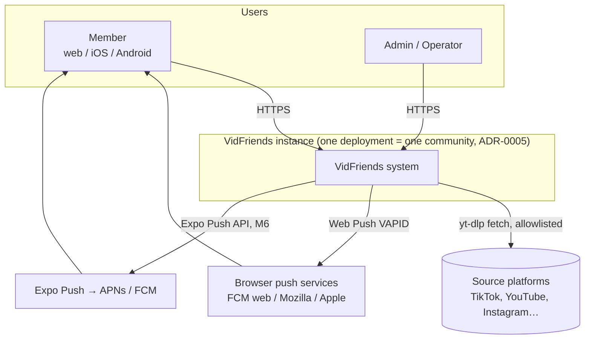
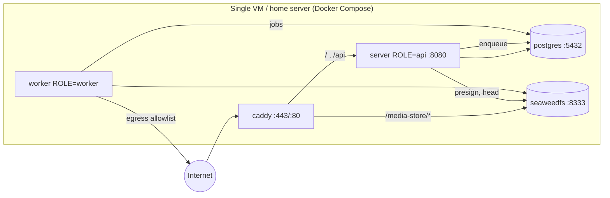

# HLD: High-Level Design

- **Status:** Draft v1
- **Owns:** system boundary, major components (`C-*`), responsibilities, trust boundaries, external integrations, deployment topology, and major data flows.
- **Details live elsewhere:** subsystem collaboration is in the [SDD](SDD.md), engineering choices in the [TDD](TDD.md), and schemas, APIs and algorithms in the [LLD](LLD.md). Decisions are in the [ADRs](../adr/).

## 1. System context



**Out of the system boundary:**
- Federation with other instances.
- Email or SMS delivery.
- Analytics vendors (NFR-PRIV-01).
- OAuth providers. Playlist import is a non-goal (CAP-17).

## 2. Components

| ID | Component | Responsibility | Tech (ADR) |
|---|---|---|---|
| C-WEB | Web client (SPA/PWA) | All member and admin UI in browsers. Service worker for install and Web Push. | React/Vite/TanStack ([0003](../adr/0003-web-client-stack.md)) |
| C-MOB | Mobile app | Member UI on iOS and Android, instance pairing, share-sheet intake, native push | Expo ([0004](../adr/0004-mobile-expo.md)) |
| C-CON | Contracts and API client | Zod schemas, route definitions, OpenAPI, typed client and Query hooks shared by C-WEB, C-MOB and C-API | [0006](../adr/0006-api-contract-first.md) |
| C-PROXY | Reverse proxy | TLS termination, HTTP→HTTPS, routes `/` and `/api` to C-API and `/media-store` to C-OBJ, security headers, access logs | Caddy 2 ([TDD §6](TDD.md#6-deployment-and-operations)) |
| C-API | API server | Serves the static SPA. Handles the HTTP API: authentication, authorization, validation, business rules, presigned URL issuance. Enqueues jobs. | Node/Hono ([0007](../adr/0007-backend-stack.md)) |
| C-WRK | Worker | Durable jobs: `video.fetch`, `video.process`, `notify.dispatch`, `retention.purge`, `storage.sweep`, `session.cleanup` | Node + pg-boss, yt-dlp, ffmpeg |
| C-DB | PostgreSQL | System of record: users, sessions, relationships, videos, shares, conversations, notifications, settings, audit log, job queue | PostgreSQL 16 |
| C-OBJ | Object storage | Media renditions, thumbnails, avatars, temporary uploads. Private bucket. | S3-compatible: SeaweedFS by default ([0009](../adr/0009-media-ingestion-and-storage.md), [0015](../adr/0015-bundled-object-store-seaweedfs.md)) |

## 3. Container and deployment topology (reference self-hosted deployment)



- Only Caddy publishes ports. Every other service binds to the internal Docker network (NFR-OPS-01).
- **Small mode:** a single `server` container with `ROLE=all` that runs both API and worker. Supported for tiny installs.
- **Alternative storage:** point C-API and C-WRK at external S3, R2 or B2, then drop SeaweedFS and the `/media-store` route. Presigned URLs then use the provider's domain.
- **Scaling path:** C-API and C-WRK are stateless. Sessions, jobs and settings live in C-DB, so replicas can be added behind Caddy. This is not needed at target scale.

## 4. Trust boundaries

| Boundary | Threats | Controls (requirements) |
|---|---|---|
| TB-1 Internet → C-PROXY | Eavesdropping, downgrade | TLS only (HSTS), security headers (NFR-SEC-04) |
| TB-2 Client → C-API | Broken authentication and authorization, CSRF, injection, enumeration, brute force | Server sessions ([0008](../adr/0008-authentication-sessions.md)); per-object authorization (NFR-SEC-01); Zod validation; parameterised SQL; rate limits (NFR-SEC-06); 404-not-403 (BR-GEN-3) |
| TB-3 Client → C-OBJ (presigned) | URL sharing or replay, enumeration | Short TTL (≤ 15 min), opaque keys, private bucket (BR-MED-7) |
| TB-4 C-WRK → Internet (fetch) | SSRF, argument injection, decompression or size bombs, malicious media exploiting ffmpeg | Host allowlist, private-IP block after DNS, `--`, size and time caps, ffmpeg in a non-root, read-only container with a dropped-capability profile (NFR-SEC-05/08) |
| TB-5 C-API/C-WRK → push services | Leaking content | Minimal payloads (BR-NOT-3) |
| TB-6 Operator ↔ data | Insider access | Stated honestly to users (FRD §1 note). Admin APIs never expose conversations (BR-ADM-1). |

The threat model is maintained in [TDD §5](TDD.md#5-security-engineering).

## 5. Major data flows

### DF-1 Send a link (J-3)

```mermaid
sequenceDiagram
  participant C as Client
  participant API as C-API
  participant DB as C-DB
  participant W as C-WRK
  participant SRC as Source platform
  participant OBJ as C-OBJ
  C->>API: POST /api/v1/videos {url}
  API->>API: validate URL (BR-MED-1), normalise
  API->>DB: find by normalised_url or insert video(queued)
  API->>DB: enqueue video.fetch
  API-->>C: 201 {video_id, status}
  C->>API: POST /api/v1/shares {video_id, recipient_ids, note, idempotency_key}
  API->>DB: insert shares (delivered_at = null while not playable)
  API-->>C: 201 per-recipient results
  W->>DB: lease video.fetch
  W->>SRC: yt-dlp (allowlisted, capped)
  W->>W: ffprobe / remux|transcode / thumbnail
  W->>OBJ: put media + thumb
  W->>DB: video ready; mark shares delivered; insert notifications; enqueue notify.dispatch
  W-->>C: Web Push / Expo push (via services)
```

### DF-2 Watch (J-4)
1. The client calls `GET /api/v1/feed`. The response contains shares with their video metadata. Media URLs are **not** embedded.
2. For the active item and the next one, the client calls `GET /api/v1/shares/{id}/media`. The server checks BR-SHR-6 and returns presigned media and thumbnail URLs with an expiry.
3. The player fetches the media directly from C-OBJ through C-PROXY, using Range requests.
4. The client sends `POST /api/v1/shares/{id}/progress` periodically. The server sets `watched_at` once the BR-SHR-3 threshold is reached and notifies the sender of `share_watched` (in-app).

### DF-3 Upload
1. The client calls `POST /api/v1/uploads` with size and content type. The server checks quota and returns a presigned PUT (or multipart presign).
2. The client uploads directly to C-OBJ.
3. The client calls `POST /api/v1/uploads/{id}/complete`. The server enqueues `video.process` (sniff, hash, dedup, process).

### DF-4 Notifications
An event inserts a `notifications` row and enqueues `notify.dispatch`. The worker loads the user's preferences and push targets, then sends Web Push or Expo push. Gone targets are deleted (BR-NOT-6).

## 6. Cross-cutting concerns (owners)

| Concern | Owner document |
|---|---|
| Authentication, sessions, CSRF | [ADR-0008](../adr/0008-authentication-sessions.md), [LLD §5](LLD.md#5-security-mechanisms) |
| Authorization model | [SDD §3](SDD.md#3-authorization-model) |
| Error model and API conventions | [ADR-0006](../adr/0006-api-contract-first.md), [LLD §3](LLD.md#3-http-api-contract) |
| Jobs, retries, idempotency | [SDD §4](SDD.md#4-asynchronous-work), [LLD §4](LLD.md#4-media-pipeline) |
| Observability, deploy, backup | [TDD §6](TDD.md#6-deployment-and-operations) |
| Testing strategy | [TDD §7](TDD.md#7-testing-and-verification-strategy) |

## 7. Explicitly inapplicable or excluded areas

| Area | Why |
|---|---|
| Multi-tenancy | Excluded ([ADR-0005](../adr/0005-instance-model.md)) |
| CDN | Not needed at instance scale. Operators may front R2 or S3 with one. |
| Search engine | Postgres `ILIKE` and trigram indexes are enough for usernames and titles |
| Compliance regimes (GDPR, CCPA) | No formal compliance obligation has been established. The design honours data minimisation and deletion (NFR-PRIV-*, NFR-DATA-01). An operator in the EU is a data controller; this is noted in the operator docs (M5). |
