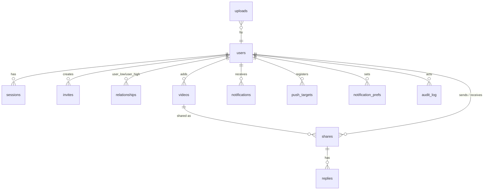

# LLD: Low-Level Design

- **Status:** Draft v1. §2–§3 are **binding for M1–M4**. Changing them requires updating this document in the same PR. §4–§5 are binding for the mechanisms they describe.
- **Owns:** the data model, the HTTP API contract outline, the media pipeline state handling, and security mechanism details.
- **Precedence:** the Zod definitions in `packages/contracts` (from M1) become the executable source of truth for the API. Once they exist, this document's §3 is the human-readable index and must be kept consistent with them.

## 1. Conventions

- **IDs:** `uuid` columns hold UUIDv7 values.
- **Timestamps:** `timestamptz NOT NULL DEFAULT now()`. All tables have `created_at`. Mutable tables also have `updated_at`, maintained by the app.
- **Enumerations:** `text` columns with `CHECK` constraints, not PG enums, so values can be added without migration pain.
- **Nullability:** null is avoided unless it means "unknown / not yet" (L-15).
- **Deletes:** cascades are only as listed. Soft-delete is used only where a placeholder is required (`replies.deleted_at`).

## 2. Data model



### Tables

**`users`**
- `id` PK
- `username` text UNIQUE, CHECK `^[a-z0-9][a-z0-9_.]{2,29}$`
- `display_name` text NOT NULL DEFAULT ''
- `avatar_key` text NULL
- `password_hash` text NOT NULL
- `role` text NOT NULL DEFAULT 'member', CHECK in (`member`, `admin`)
- `status` text NOT NULL DEFAULT 'active', CHECK in (`active`, `suspended`)
- `storage_bytes` bigint NOT NULL DEFAULT 0
- `quota_bytes_override` bigint NULL (null means the instance default)
- `last_active_at` timestamptz NULL
- `created_at`, `updated_at`
- Index: trigram on `display_name`.

**`sessions`**
- `token_hash` bytea PK (sha256)
- `id` uuid UNIQUE: a public handle so a session can be listed and revoked (FR-ACCT-04) without exposing its token hash
- `user_id` FK → users ON DELETE CASCADE
- `client` text CHECK in (`web`, `mobile`)
- `user_agent` text NOT NULL DEFAULT ''
- `created_at`
- `last_seen_at`
- `idle_expires_at`
- `absolute_expires_at`
- Index on (`user_id`).

**`invites`**
- `id` PK
- `code_hash` bytea UNIQUE
- `created_by` FK users ON DELETE CASCADE
- `max_uses` int CHECK 1..50
- `uses` int DEFAULT 0, CHECK `uses <= max_uses`
- `auto_friend` bool
- `expires_at`
- `revoked_at` NULL
- `created_at`

**`invite_redemptions`**
- `invite_id` FK CASCADE
- `user_id` FK CASCADE
- `created_at`
- PK (`invite_id`, `user_id`)

**`relationships`** (one row per pair, BR-FRND-2)
- `user_low`, `user_high`: FK users CASCADE, CHECK `user_low < user_high`, PK (`user_low`, `user_high`)
- `state` text CHECK in (`pending`, `accepted`, `blocked`)
- `requested_by` uuid NULL (set when `pending`)
- `blocked_by` uuid NULL (set when `blocked`)
- `cooldown_until` timestamptz NULL (decline cooldown, BR-FRND-4)
- `updated_at`
- Partial indexes on `(user_low)` and `(user_high)` WHERE `state='accepted'`.

**`videos`**
- `id` PK
- `added_by` FK users ON DELETE SET NULL
- `source_kind` CHECK in (`link`, `upload`)
- `source_url` text NULL
- `normalized_url` text NULL, UNIQUE where not null
- `platform` text NULL
- `sha256` bytea NULL, UNIQUE where not null
- `state` CHECK in (`queued`, `fetching`, `processing`, `ready`, `link_only`, `failed`, `expired`)
- `failure_reason` text NULL
- `title` text NOT NULL DEFAULT ''
- `author_handle` text NULL
- `duration_ms` int NULL, `width` int NULL, `height` int NULL
- `media_key` text NULL, `thumb_key` text NULL
- `media_bytes` bigint NOT NULL DEFAULT 0
- `created_at`, `updated_at`, `ready_at` NULL, `expired_at` NULL

**`uploads`**
- `id` PK
- `user_id` FK CASCADE
- `object_key` text
- `declared_bytes` bigint
- `content_type` text
- `state` CHECK in (`pending`, `completed`, `aborted`)
- `video_id` NULL FK videos SET NULL
- `expires_at`
- `created_at`

**`shares`**
- `id` PK
- `video_id` FK videos CASCADE
- `sender_id` FK users CASCADE
- `recipient_id` FK users CASCADE, CHECK `sender_id <> recipient_id`
- `note` text NOT NULL DEFAULT '' CHECK length ≤ 500
- `delivered_at` NULL
- `watched_at` NULL
- `progress_ms` int NOT NULL DEFAULT 0
- `saved` bool DEFAULT false
- `hidden` bool DEFAULT false
- `reaction` text NULL, CHECK in the fixed set
- `reaction_at` NULL
- `created_at`
- UNIQUE (`sender_id`, `recipient_id`, `video_id`)
- Indexes:
  - feed: (`recipient_id`, `watched_at` NULLS FIRST, `delivered_at`, `id`) WHERE `hidden = false AND delivered_at IS NOT NULL`
  - (`sender_id`, `created_at` DESC)
  - (`video_id`)

**`send_requests`** (idempotency)
- `sender_id`
- `idempotency_key` text
- `response` jsonb
- `created_at`
- PK (`sender_id`, `idempotency_key`). Purged after 24 h.

**`replies`**
- `id` PK
- `share_id` FK shares CASCADE
- `author_id` FK users CASCADE
- `body` text CHECK 1..1000
- `deleted_at` NULL
- `created_at`
- Index (`share_id`, `created_at`).

**`notifications`**
- `id` PK
- `user_id` FK CASCADE
- `type` CHECK in the BR-NOT-1 types
- `actor_id` NULL FK users SET NULL
- `share_id` NULL FK shares CASCADE
- `data` jsonb NOT NULL DEFAULT '{}'. No content; ids only.
- `read_at` NULL
- `created_at`
- Index (`user_id`, `read_at` NULLS FIRST, `created_at` DESC).

**`notification_prefs`**
- `user_id`
- `type`
- `channel` CHECK in (`push`)
- `enabled` bool
- PK (`user_id`, `type`, `channel`). A missing row means the default (BR-NOT-2).

**`push_targets`**
- `id` PK
- `user_id` FK CASCADE
- `kind` CHECK in (`webpush`, `expo`)
- `endpoint` text UNIQUE
- `p256dh` text NULL, `auth` text NULL
- `private_previews` bool DEFAULT false
- `created_at`
- `last_success_at` NULL

**`instance_settings`**
- `key` text PK
- `value` jsonb
- `updated_by` NULL
- `updated_at`
- Keys are listed in FRD WF-ADM-3 and validated by a Zod schema.

**`instance_secrets`**
- `key` text PK, e.g. `vapid`
- `ciphertext` bytea (AES-256-GCM with a key derived from `APP_SECRET`)
- `created_at`

**`password_resets`**
- `token_hash` bytea PK
- `user_id` FK CASCADE
- `created_by` FK users
- `expires_at`
- `used_at` NULL

**`audit_log`**
- `id` bigserial PK
- `actor_id` uuid NULL (no FK, so entries survive account deletion)
- `action` text
- `target_type` text NULL, `target_id` text NULL
- `metadata` jsonb
- `ip` inet NULL
- `created_at`
- Index (`created_at` DESC), (`actor_id`), (`action`). The table is append-only: the application role has no UPDATE or DELETE grant except for the 365-day purge job.

pg-boss manages its own `pgboss.*` schema.

### Key queries

**Feed** (BR-FEED-1), keyset over (`watched_at IS NOT NULL`, `delivered_at`, `id`):

```sql
SELECT s.*, v.title, v.duration_ms, v.state, v.thumb_key, u.username, u.display_name
FROM shares s JOIN videos v ON v.id = s.video_id JOIN users u ON u.id = s.sender_id
WHERE s.recipient_id = :viewer AND s.hidden = false AND s.delivered_at IS NOT NULL
  AND u.status = 'active'
  AND NOT EXISTS (SELECT 1 FROM relationships r WHERE r.state='blocked'
                  AND (r.user_low, r.user_high) = (LEAST(:viewer, s.sender_id), GREATEST(:viewer, s.sender_id)))
  AND (/* cursor predicate */)
ORDER BY (s.watched_at IS NOT NULL), s.delivered_at, s.id
LIMIT :n + 1;
```

- "Also sent by" grouping (BR-FEED-7) is done in the service over each page by `video_id`.
- Watching one share stamps all unwatched shares of that video for the viewer in one UPDATE.

**Storage accounting.** `users.storage_bytes` is updated in the same transaction as `videos.media_bytes` changes (ready, purge). It is never computed lazily (lesson: legacy drift).

## 3. HTTP API contract

- **Base:** `/api/v1`.
- **Auth column:** P = public, M = member, A = admin.
- **Errors:** listed as codes. HTTP status per the [SDD](SDD.md#2-request-pipeline) error mapper.
- **Pagination:** `?cursor=&limit=` → `{items, next_cursor}`.

| Method & path | Auth | Request → response (summary) | Notable errors | FR |
|---|---|---|---|---|
| `GET /instance` | P | → `{name, version, api_version, signup_mode, setup_complete}` | – | PAIR-01 |
| `POST /setup` | P | `{setup_token, instance_name, username, password}` → `{user}` + session | `setup_invalid`, 404 if complete | AUTH-01 |
| `GET /invites/{code}/preview` | P | → `{inviter_display_name, expires_at}` | `invite_invalid` | PAIR-04 |
| `POST /auth/register` | P | `{username, password, display_name?, invite_code?, client}` → `{user, token?}` | `invite_invalid`, `username_taken`, `validation_failed` | AUTH-02/03 |
| `POST /auth/login` | P | `{username, password, client}` → `{user, token?}` (token only for mobile; web gets a cookie) | `invalid_credentials`, `account_suspended`, `rate_limited` | AUTH-04 |
| `POST /auth/logout` | M | `{all?: bool}` → 204 | – | AUTH-04 |
| `GET /me` | M | → `{user, settings_summary}` | – | – |
| `PATCH /me` | M | `{display_name?}` → `{user}` | – | ACCT-01 |
| `PUT /me/avatar` | M | presigned flow like uploads → `{user}` | `too_large` | ACCT-01 |
| `POST /me/password` | M | `{current_password, new_password}` → 204 | `invalid_credentials` | ACCT-02 |
| `DELETE /me` | M | `{password}` → 202 | `last_admin`, `invalid_credentials` | ACCT-03 |
| `GET /me/sessions`, `DELETE /me/sessions/{id}` | M | list / revoke | – | ACCT-04 |
| `POST /invites`, `GET /invites`, `DELETE /invites/{id}` | M/A | `{max_uses?, expires_in_days?, auto_friend?}` → `{invite, code, join_url}` (code returned once) | `forbidden` if members cannot invite | INV-01..03 |
| `GET /users?q=` | M | → `{items:[{id, username, display_name, avatar_url, relationship}]}` | `query_too_short` | FRND-01 |
| `GET /friends`, `GET /friends/requests?direction=in\|out`, `GET /blocks` | M | lists | – | FRND-05 |
| `POST /friends/requests` | M | `{user_id}` → `{relationship}` | `cooldown`, `blocked` (as 404), `already_friends`, `rate_limited` | FRND-02,04 |
| `POST /friends/requests/{user_id}/accept` / `…/decline` / `DELETE /friends/requests/{user_id}` (cancel) | M | → `{relationship}` / 204 | `not_found` | FRND-02 |
| `DELETE /friends/{user_id}` | M | → 204 | – | FRND-02 |
| `PUT /blocks/{user_id}`, `DELETE /blocks/{user_id}` | M | → 204 | – | FRND-03 |
| `POST /videos` | M | `{url}` → `{video:{id, state, title?…}}` (201 new, 200 reused) | `url_not_allowed`, `quota_exceeded` | VID-01,02,07 |
| `POST /uploads` | M | `{bytes, content_type}` → `{upload_id, put_url \| multipart:{part_urls, …}, expires_at}` | `too_large`, `quota_exceeded`, `storage_full` | VID-03 |
| `POST /uploads/{id}/complete` | M | `{title?, parts?}` → `{video}` | `upload_incomplete` | VID-03 |
| `GET /videos/{id}` | M | → `{video}` (visibility per BR-SHR-6) | 404 | VID-05 |
| `POST /shares` | M | `{video_id, recipient_ids[], note?, idempotency_key}` → `{results:[{recipient_id, status, share_id?}]}` | `video_not_found` | SHR-01,02 |
| `DELETE /shares/{id}` | M (sender) | → 204 | `already_watched` | SHR-04 |
| `GET /shares/{id}` | M (participant) | → `{share, video, sender, recipient, reaction, reply_count}` | 404 | – |
| `GET /shares/{id}/media` | M (participant) | → `{media_url?, thumb_url?, expires_at}` | 404, `not_playable` | VID-05 |
| `POST /shares/{id}/progress` | M (recipient) | `{position_ms, duration_ms}` → `{watched_at?}` | – | FEED-03 |
| `PATCH /shares/{id}` | M (recipient) | `{saved?, hidden?}` → `{share}` | – | FEED-04 |
| `PUT /shares/{id}/reaction`, `DELETE …/reaction` | M (recipient) | `{emoji}` → `{share}` | `invalid_reaction` | ENG-01 |
| `GET /shares/{id}/replies`, `POST …/replies`, `DELETE /replies/{id}` | M (participant / author) | `{body}` → `{reply}` | `rate_limited` | ENG-02 |
| `GET /feed`, `GET /inbox`, `GET /saved`, `GET /history?sender=&q=`, `GET /sent` | M | paginated share lists (BR-FEED-*) | – | FEED-01,02; SHR-05 |
| `GET /notifications`, `POST /notifications/read` `{ids? \| all}` , `GET /notifications/unread-count` | M | list / mark / count | – | NOTIF-01,05 |
| `GET /notification-prefs`, `PUT /notification-prefs` | M | matrix of type × channel | – | NOTIF-04 |
| `GET /push/vapid-public-key` | M | → `{key}` | – | NOTIF-02 |
| `POST /push-targets`, `DELETE /push-targets/{id}` | M | `{kind, endpoint, keys?, private_previews?}` | – | NOTIF-02,03 |
| `GET /admin/users?q=&status=`, `PATCH /admin/users/{id}` `{status?, role?, quota_bytes_override?}`, `DELETE /admin/users/{id}`, `POST /admin/users/{id}/password-reset` | A | … → `{user}` / `{reset_url}` | `last_admin` | ADM-01,03 |
| `GET /admin/settings`, `PATCH /admin/settings` | A | settings object | `validation_failed` | ADM-02 |
| `GET /admin/storage`, `POST /admin/retention/run` | A | stats / 202 | – | ADM-04 |
| `GET /admin/audit?actor=&action=&before=` | A | paginated | – | ADM-05 |
| `POST /auth/password-reset/{token}` | P | `{new_password}` → 204 | `reset_invalid` | ADM-03 |

Ops endpoints live outside `/api/v1`: `GET /healthz`, `GET /readyz`, and `GET :9464/metrics` (internal port).

## 4. Media pipeline

### Video state transitions (FRD §5)

| From → To | Actor | Guard | Side effects |
|---|---|---|---|
| (new) → `queued` | API | URL valid; no existing `normalized_url` | enqueue `video.fetch` (same transaction) |
| `queued` → `fetching` | worker | lease acquired; `link_download_enabled` | – |
| `queued` → `link_only` | worker | downloads disabled | optional metadata-only probe (`yt-dlp --skip-download -J`) for title and thumbnail |
| `fetching` → `processing` | worker | file downloaded within limits | stream to temp; compute sha256 |
| `fetching` → `link_only` | worker | retries exhausted or limit exceeded | `failure_reason` set |
| `processing` → `ready` | worker | probe ok; renditions uploaded | `users.storage_bytes += media_bytes`; finalize shares (deliver + notify) |
| `processing` → `failed` | worker | unplayable after transcode attempt | for uploads, notify the uploader; for links, fall back to `link_only` |
| `ready` → `expired` | retention | BR-MED-5 eligibility | delete objects after commit; storage bytes decremented |

**Finalize shares** (inside the transaction that marks the video ready or link-only):
1. `UPDATE shares SET delivered_at = now() WHERE video_id = :id AND delivered_at IS NULL RETURNING …`.
2. Insert `share_received` notifications.
3. Enqueue `notify.dispatch`, coalescing per BR-NOT-4 via a 2-minute singleton key `notify:<recipient>:<sender>`.

**Shares to an already-ready video** set `delivered_at = now()` at insert time.

**Retention eligibility** (BR-MED-5), evaluated per video:
- It is eligible when no share has `saved = true`.
- **And** for every share: `COALESCE(watched_at, created_at) < now() - retention_days`.
- Videos with zero shares are eligible 24 h after `created_at`. That grace period covers add-then-send.

**URL normalisation:**
1. Lower-case the host and strip `www.` and `m.`.
2. Remove `utm_*`, `si`, `feature`, `igshid`, `_r` and `is_from_webapp` query parameters.
3. Canonicalise known forms: `youtu.be/<id>` → `youtube.com/watch?v=<id>`, and `/shorts/<id>` kept as shorts.
4. Short-link hosts (`vm.tiktok.com`, `vt.tiktok.com`) are resolved by one HEAD request with redirect-follow limited to allowlisted hosts.

## 5. Security mechanisms

- **argon2id parameters:** memory 19 MiB, iterations 2, parallelism 1 (the OWASP 2023 minimum), tuned at M1 so a hash takes about 50–100 ms on the reference host.
- **Tokens:**
  - 32 random bytes, base64url encoded.
  - Stored as `sha256` digests.
  - Compared by database lookup of the hash, which has no timing side channel on the secret.
- **Setup token:** 32 bytes, kept in memory only, printed once per boot while unclaimed (FR-AUTH-01).
- **CSRF:**
  - On login, the server sets a non-HttpOnly `vf_csrf` cookie whose value is `HMAC-SHA256(APP_SECRET, "csrf:" ‖ session token hash)`, so the token is bound to the session (signed double-submit).
  - Unsafe requests authenticated by cookie must send `X-CSRF-Token` equal to that cookie, **and** have an `Origin` header matching `PUBLIC_URL`.
  - Bearer-authenticated requests are exempt.
- **CSP:** `default-src 'self'; img-src 'self' blob: data: {media origin}; media-src 'self' blob: {media origin}; connect-src 'self'; script-src 'self'; style-src 'self' 'unsafe-inline'; frame-ancestors 'none'; base-uri 'none'`.
  - `{media origin}` is the configured S3 public endpoint origin.
  - `'unsafe-inline'` for styles is needed for Radix positioning. Revisit later.
- **Password reset links:** `https://<host>/reset/<token>`, valid for 24 h, single use. All of the user's sessions are revoked on use.
- **Log redaction:** the pino `redact` paths cover `req.headers.cookie`, `req.headers.authorization`, and `*.password`, `*.token`, `*.code`, `*.note`, `*.body` and `*.endpoint`. A unit test asserts the redaction (NFR-PRIV-02).
