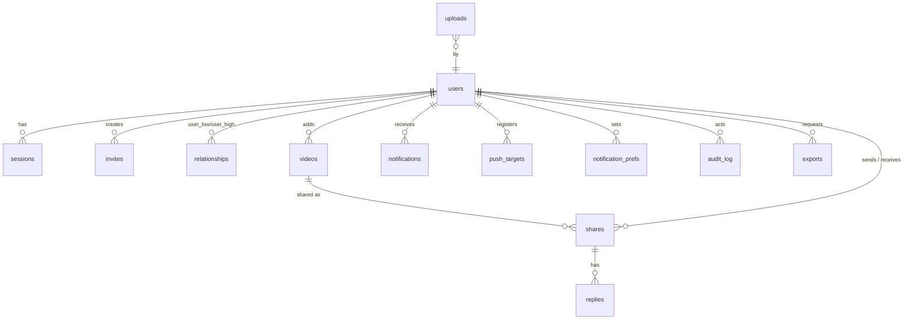

# LLD: Low-Level Design

- **Status:** Draft v1. §2–§3 are **binding for M1–M4**. Changing them requires updating this document in the same PR. §4–§5 are binding for the mechanisms they describe.
- **Owns:** the data model, the HTTP API contract outline, the media pipeline state handling, and security mechanism details.
- **Precedence:** the Zod definitions in `packages/contracts` (from M1) become the executable source of truth for the API. Once they exist, this document's §3 is the human-readable index and must be kept consistent with them.

## 1. Conventions

- **IDs:** `uuid` columns hold UUIDv7 values.
- **Timestamps:** `timestamptz NOT NULL DEFAULT now()`. All tables have `created_at`. Mutable tables also have `updated_at`, maintained by the app.
- **Enumerations:** `text` columns with `CHECK` constraints, not PG enums, so values can be added without migration pain.
- **Nullability:** null is avoided unless it means "unknown / not yet" (L-15).
- **Deletes:** cascades are only as listed. Soft-delete is used only where a placeholder is required (`replies.deleted_at`).

## 2. Data model



### Tables

**`users`**
- `id` PK
- `username` text UNIQUE, CHECK `^[a-z0-9][a-z0-9_.]{2,29}$`
- `display_name` text NOT NULL DEFAULT ''
- `avatar_key` text NULL
- `role` text NOT NULL DEFAULT 'member', CHECK in (`member`, `admin`)
- `status` text NOT NULL DEFAULT 'active', CHECK in (`active`, `suspended`)
- `language` text NOT NULL DEFAULT 'en', CHECK in (`en`, `es`): language of server-written texts (push titles), set by the client (NFR-I18N-01)
- `storage_bytes` bigint NOT NULL DEFAULT 0
- `quota_bytes_override` bigint NULL (null means the instance default)
- `last_active_at` timestamptz NULL
- `created_at`, `updated_at`
- Index: trigram on `display_name`.

**`sessions`**
- `token_hash` bytea PK (sha256)
- `id` uuid UNIQUE: a public handle so a session can be listed and revoked (FR-ACCT-04) without exposing its token hash
- `user_id` FK → users ON DELETE CASCADE
- `client` text CHECK in (`web`, `mobile`)
- `user_agent` text NOT NULL DEFAULT ''
- `created_at`
- `last_seen_at`
- `idle_expires_at`
- `absolute_expires_at`
- Index on (`user_id`).

**`invites`**
- `id` PK
- `code_hash` bytea UNIQUE
- `created_by` FK users ON DELETE CASCADE
- `max_uses` int CHECK 1..50
- `uses` int DEFAULT 0, CHECK `uses <= max_uses`
- `auto_friend` bool
- `expires_at`
- `revoked_at` NULL
- `created_at`

**`invite_redemptions`**
- `invite_id` FK CASCADE
- `user_id` FK CASCADE
- `created_at`
- PK (`invite_id`, `user_id`)

**`friend_groups`** (BR-GRP-1)
- `id` PK, `owner_id` FK users CASCADE, `name` text (1–40), `created_at`
- UNIQUE (`owner_id`, lower(`name`))

**`friend_group_members`**
- `group_id` FK friend_groups CASCADE, `user_id` FK users CASCADE; PK (`group_id`, `user_id`)

**`relationships`** (one row per pair, BR-FRND-2)
- `user_low`, `user_high`: FK users CASCADE, CHECK `user_low < user_high`, PK (`user_low`, `user_high`)
- `state` text CHECK in (`none`, `pending`, `accepted`, `blocked`). `none` is a tombstone that only carries a decline cooldown (BR-FRND-4): `requested_by` then names the declined requester and `cooldown_until` when they may ask again. Migration 0001.
- `requested_by` uuid NULL (set when `pending`)
- `blocked_by` uuid NULL (set when `blocked`)
- `cooldown_until` timestamptz NULL (decline cooldown, BR-FRND-4)
- `updated_at`
- Partial indexes on `(user_low)` and `(user_high)` WHERE `state='accepted'`.

**`videos`**
- `id` PK
- `added_by` FK users ON DELETE SET NULL
- `source_kind` CHECK in (`link`, `upload`)
- `source_url` text NULL
- `normalized_url` text NULL, UNIQUE where not null
- `platform` text NULL
- `sha256` bytea NULL, UNIQUE where not null
- `state` CHECK in (`queued`, `fetching`, `processing`, `ready`, `link_only`, `failed`, `expired`)
- `failure_reason` text NULL
- `title` text NOT NULL DEFAULT ''
- `author_handle` text NULL
- `duration_ms` int NULL, `width` int NULL, `height` int NULL
- `media_key` text NULL, `thumb_key` text NULL
- `media_bytes` bigint NOT NULL DEFAULT 0
- `media_reused` boolean NOT NULL DEFAULT false: the file was stored for another video and is reused (perceptual dedup, ADR-0022); such a video is never charged for it. Migration 0010.
- `created_at`, `updated_at`, `ready_at` NULL, `expired_at` NULL

**`video_fingerprints`** (BR-MED-4, ADR-0022, migration 0010)
- `video_id` PK FK videos CASCADE, `duration_ms` int, `width`, `height`, `hashes` bytea (8 × 64-bit pHash), `mask` int (usable frames), `created_at`
- INDEX (`duration_ms`) for candidate lookup

**`video_additions`** (migration 0002)
- `video_id` FK videos CASCADE, `user_id` FK users CASCADE, `created_at`; PK (`video_id`, `user_id`)
- One row per member who added the video, by link or upload. Dedup reuses media only (BR-MED-4), so a member who adds an existing video gets a row here: it drives visibility (BR-SHR-6) and the send precondition (WF-SHR-1). `videos.added_by` remains the first adder, for quota attribution (BR-MED-6).

**`uploads`**
- `id` PK
- `user_id` FK CASCADE
- `object_key` text
- `declared_bytes` bigint
- `content_type` text
- `multipart_id` text NULL (S3 multipart upload id for files above 64 MB)
- `state` CHECK in (`pending`, `completed`, `aborted`)
- `video_id` NULL FK videos SET NULL
- `expires_at`
- `created_at`

**`shares`**
- `id` PK
- `video_id` FK videos CASCADE
- `sender_id` FK users CASCADE
- `recipient_id` FK users CASCADE, CHECK `sender_id <> recipient_id`
- `note` text NOT NULL DEFAULT '' CHECK length ≤ 500
- `delivered_at` NULL
- `watched_at` NULL
- `progress_ms` int NOT NULL DEFAULT 0
- `saved` bool DEFAULT false
- `saved_at` NULL (orders the Saved view, BR-FEED-3; migration 0003)
- `hidden` bool DEFAULT false
- `reaction` text NULL, CHECK in the fixed set
- `reaction_at` NULL
- `created_at`
- UNIQUE (`sender_id`, `recipient_id`, `video_id`)
- Indexes:
  - feed: (`recipient_id`, `watched_at` NULLS FIRST, `delivered_at`, `id`) WHERE `hidden = false AND delivered_at IS NOT NULL`
  - (`sender_id`, `created_at` DESC)
  - (`video_id`)

**`send_requests`** (idempotency)
- `sender_id`
- `idempotency_key` text
- `response` jsonb
- `created_at`
- PK (`sender_id`, `idempotency_key`). Purged after 24 h.

**`collections`** (BR-COL-1, migration 0009)
- `id` PK, `owner_id` FK users CASCADE, `name` text (1–60), `created_at`
- UNIQUE (`owner_id`, lower(`name`))

**`collection_items`** (BR-COL-2/3)
- `collection_id` FK collections CASCADE, `share_id` FK shares CASCADE, `added_at`; PK (`collection_id`, `share_id`)
- INDEX (`collection_id`, `added_at` DESC, `share_id` DESC) for the list; INDEX (`share_id`) so unsaving can clear a share from every collection

**`replies`**
- `id` PK
- `share_id` FK shares CASCADE
- `author_id` FK users CASCADE
- `body` text CHECK 1..1000
- `deleted_at` NULL
- `created_at`
- Index (`share_id`, `created_at`).

**`notifications`**
- `id` PK
- `user_id` FK CASCADE
- `type` CHECK in the BR-NOT-1 types
- `actor_id` NULL FK users SET NULL
- `share_id` NULL FK shares CASCADE
- `data` jsonb NOT NULL DEFAULT '{}'. No content; ids only.
- `read_at` NULL
- `pushed_at` NULL (set when the dispatcher has handled it; coalescing collects unpushed `share_received` rows from one sender, BR-NOT-4)
- `created_at`
- Index (`user_id`, `read_at` NULLS FIRST, `created_at` DESC).

**`notification_prefs`**
- `user_id`
- `type`
- `channel` CHECK in (`push`)
- `enabled` bool
- PK (`user_id`, `type`, `channel`). A missing row means the default (BR-NOT-2).

**`push_targets`**
- `id` PK
- `user_id` FK CASCADE
- `kind` CHECK in (`webpush`, `expo`, `ntfy`, `gotify`, `unifiedpush`) (`unifiedpush`: migration 0011, ADR-0024)
- `endpoint` text: UNIQUE for `webpush`/`expo`/`unifiedpush` (a re-subscribing device takes it over); UNIQUE per `(user_id, endpoint)` for `ntfy`/`gotify` (ADR-0020)
- `p256dh` text NULL, `auth` text NULL (Web Push keys for `webpush` and `unifiedpush`)
- `secret` bytea NULL: the ntfy/Gotify token, AES-256-GCM under a key derived from `APP_SECRET`
- `private_previews` bool DEFAULT false
- `created_at`
- `last_success_at` NULL

**`instance_settings`**
- `key` text PK
- `value` jsonb
- `updated_by` NULL
- `updated_at`
- Keys are listed in FRD WF-ADM-3 and validated by a Zod schema.

**`instance_secrets`**
- `key` text PK, e.g. `vapid`
- `ciphertext` bytea (AES-256-GCM with a key derived from `APP_SECRET`)
- `created_at`

**`passkeys`** ([ADR-0018](../adr/0018-passkey-only-sign-in.md))
- `id` PK
- `user_id` FK CASCADE
- `credential_id` text UNIQUE (base64url)
- `public_key` bytea, `counter` bigint, `transports` text[], `backed_up` boolean
- `name` text NOT NULL (≤ 50)
- `created_at`, `last_used_at` NULL
- Index (`user_id`).

**`webauthn_challenges`**
- `id` PK (the ceremony id returned to the client)
- `challenge` text (base64url, 32 random bytes)
- `purpose` text CHECK in (`setup`, `register`, `recover`, `add`, `signin`, `reauth`)
- `user_id` uuid NULL, `context` jsonb (username, display name, invite or recovery token hash: what the ceremony will create)
- `expires_at` (5 minutes); deleted when used.

**`recovery_tokens`** (replaces `password_resets`)
- `token_hash` bytea PK
- `user_id` FK CASCADE
- `created_by` FK users NULL (null when printed by the `recovery-link` server command)
- `expires_at`, `used_at` NULL

**`mobile_auth_codes`** (browser hand-off, WF-AUTH-5)
- `code_hash` bytea PK
- `user_id` FK CASCADE
- `code_challenge` text (S256)
- `expires_at` (60 seconds), `used_at` NULL

`sessions` gains `passkey_id` FK NULL (ON DELETE CASCADE: removing a passkey revokes the sessions it created) and `reauth_at` NULL (the last passkey confirmation, for WF-ACCT-2/3).

**`audit_log`**
- `id` bigserial PK
- `actor_id` uuid NULL (no FK, so entries survive account deletion)
- `action` text
- `target_type` text NULL, `target_id` text NULL
- `metadata` jsonb
- `ip` inet NULL
- `created_at`
- Index (`created_at` DESC), (`actor_id`), (`action`). The table is append-only: the application role has no UPDATE or DELETE grant except for the 365-day purge job.

**`exports`** (FR-ACCT-05, WF-ACCT-4)
- `id` PK, `user_id` FK CASCADE
- `include_media` boolean NOT NULL
- `state` text NOT NULL, CHECK in (`queued`, `building`, `ready`, `failed`, `expired`)
- `object_key` text NULL (`exports/{user_id}/{id}.zip` once ready), `bytes` bigint NULL, `error` text NULL
- `created_at`, `ready_at` NULL, `expires_at` NULL (ready + 7 days)
- Index (`user_id`, `created_at` DESC). At most one row per user in `queued`/`building` (partial unique index).

pg-boss manages its own `pgboss.*` schema.

### Key queries

**Feed** (BR-FEED-1), keyset over (`watched_at IS NOT NULL`, `delivered_at`, `id`):

```sql
SELECT s.*, v.title, v.duration_ms, v.state, v.thumb_key, u.username, u.display_name
FROM shares s JOIN videos v ON v.id = s.video_id JOIN users u ON u.id = s.sender_id
WHERE s.recipient_id = :viewer AND s.hidden = false AND s.delivered_at IS NOT NULL
  AND u.status = 'active'
  AND NOT EXISTS (SELECT 1 FROM relationships r WHERE r.state='blocked'
                  AND (r.user_low, r.user_high) = (LEAST(:viewer, s.sender_id), GREATEST(:viewer, s.sender_id)))
  AND (/* cursor predicate */)
ORDER BY (s.watched_at IS NOT NULL), s.delivered_at, s.id
LIMIT :n + 1;
```

- "Also sent by" grouping (BR-FEED-7): the feed picks one share per video (`DISTINCT ON (video_id)`, preferring an unwatched one, then the earliest delivered), and lists the other senders.
- The feed has two sections, matching BR-FEED-1: unwatched shares by `delivered_at` ascending, then watched shares by `watched_at` descending. The keyset cursor is `(section, timestamp, id)`.
- Watching one share stamps all unwatched shares of that video for the viewer in one UPDATE.

**Storage accounting.** `users.storage_bytes` is updated in the same transaction as `videos.media_bytes` changes (ready, purge). It is never computed lazily (lesson: legacy drift).

## 3. HTTP API contract

- **Base:** `/api/v1`.
- **Auth column:** P = public, M = member, A = admin.
- **Errors:** listed as codes. HTTP status per the [SDD](SDD.md#2-request-pipeline) error mapper.
- **Pagination:** `?cursor=&limit=` → `{items, next_cursor}`.

| Method & path | Auth | Request → response (summary) | Notable errors | FR |
|---|---|---|---|---|
| `GET /instance` | P | → `{name, version, api_version, signup_mode, setup_complete, retention_days}` | – | PAIR-01 |
| `POST /setup/options` | P | `{setup_token, instance_name, username, display_name?}` → `{ceremony_id, options}` (WebAuthn creation options) | `setup_invalid`, `validation_failed`, 404 if complete | AUTH-01 |
| `POST /setup` | P | `{ceremony_id, credential, passkey_name?}` → `{user}` + session | `ceremony_invalid`, `passkey_invalid`, 404 if complete | AUTH-01 |
| `GET /invites/{code}/preview` | P | → `{inviter_display_name, expires_at}` | `invite_invalid` | PAIR-04 |
| `POST /auth/register/options` | P | `{username, display_name?, invite_code?}` → `{ceremony_id, options}` | `invite_invalid`, `username_taken`, `validation_failed` | AUTH-02/03 |
| `POST /auth/register` | P | `{ceremony_id, credential, passkey_name?}` → `{user}` + cookie session | `ceremony_invalid`, `passkey_invalid`, `invite_invalid`, `username_taken` | AUTH-02/03 |
| `POST /auth/signin/options` | P | `{}` → `{ceremony_id, options}` (discoverable: no allow-list) | `rate_limited` | AUTH-04 |
| `POST /auth/signin` | P | `{ceremony_id, credential}` → `{user}` + cookie session | `invalid_credentials`, `account_suspended`, `rate_limited` | AUTH-04 |
| `POST /auth/logout` | M | `{all?: bool}` → 204 | – | AUTH-04 |
| `GET /me` | M | → `{user, settings_summary}` | – | – |
| `PATCH /me` | M | `{display_name?, language?: en\|es}` (at least one) → `{user}`; `language` sets the language of server-written texts such as push titles | – | ACCT-01, NFR-I18N-01 |
| `POST /me/avatar/upload`, `PUT /me/avatar`, `DELETE /me/avatar` | M | `{bytes, content_type}` → `{upload_id, put_url, expires_at}` (presigned PUT to `tmp/avatars/<user>/<upload_id>`, ≤ 2 MB); then `{upload_id}` → `{user}` after re-encoding to a 256×256 WebP; delete → `{user}` | `too_large`, `upload_incomplete`, `validation_failed` (`not_an_image`) | ACCT-01 |
| `GET /users/{user_id}/avatar` | M | → 302 to a signed URL (≤ 15 min). 404 when the viewer is blocked by, or blocking, the user | 404 | ACCT-01 |
| `GET /users/{user_id}/avatar-url` | M | → `{url, expires_at}`: the same signed URL as data, for bearer clients (the redirect would carry their `Authorization` header to the store). Same visibility as `/avatar` | 404 | ACCT-01, MOB-01 |
| `POST /auth/mobile/code` | M (cookie) | `{code_challenge}` → `{code}`: single-use, 60 s; the `/app-auth` page then redirects to `vidfriends://auth?code=…&state=…` and logs its web session out | `validation_failed` | AUTH-04 |
| `POST /auth/mobile/token` | P | `{code, code_verifier}` → `{user, token}` (bearer session, `client: mobile`) | `code_invalid`, `account_suspended` | AUTH-04 |
| `GET /me/passkeys` | M | → `{items: Passkey[]}` (`id, name, created_at, last_used_at, backed_up, current`) | – | ACCT-02 |
| `POST /me/passkeys/options`, `POST /me/passkeys` | M | `{}` → `{ceremony_id, options}`; `{ceremony_id, credential, name?}` → `{passkey}` | `ceremony_invalid`, `passkey_invalid`, `too_many_passkeys` | ACCT-02 |
| `PATCH /me/passkeys/{id}`, `DELETE /me/passkeys/{id}` | M | `{name}` → `{passkey}`; delete → 204 (needs `reauth_at` within 5 min) | `reauth_required`, `last_passkey`, 404 | ACCT-02 |
| `POST /me/reauth/options`, `POST /me/reauth` | M | `{}` → `{ceremony_id, options}` (the user's own passkeys); `{ceremony_id, credential}` → 204, sets `reauth_at` | `ceremony_invalid`, `invalid_credentials` | ACCT-02/03 |
| `DELETE /me` | M | `{}` → 202 (needs `reauth_at` within 5 min) | `last_admin`, `reauth_required` | ACCT-03 |
| `GET /me/sessions`, `DELETE /me/sessions/{id}` | M | list / revoke | – | ACCT-04 |
| `POST /me/exports` | M | `{include_media}` → 202 `{export}`; one in progress, 3 per 24 h | `export_in_progress`, `rate_limited` | ACCT-05 |
| `GET /me/exports` | M | → `{items: Export[]}` newest first | – | ACCT-05 |
| `GET /me/exports/{id}/download` | M | → 302 to a signed URL (≤ 15 min) while ready; owner only | 404 | ACCT-05 |
| `GET /me/exports/{id}/download-url` | M | → `{url, expires_at}`: the same signed URL as data, for bearer clients (the mobile app opens it in the browser). Owner only | 404 | ACCT-05, MOB-01 |
| `POST /invites`, `GET /invites`, `DELETE /invites/{id}` | M/A | `{max_uses?, expires_in_days?, auto_friend?}` → `{invite, code, join_url}` (code returned once) | `forbidden` if members cannot invite | INV-01..03 |
| `GET /users?q=` | M | → `{items:[{user:{id, username, display_name, avatar_url}, state, since}]}`; `state` ∈ `none`, `friends`, `request_sent`, `request_received`, `blocked` | `query_too_short` | FRND-01 |
| `GET /friends`, `GET /friends/requests?direction=in\|out`, `GET /blocks` | M | lists | – | FRND-05 |
| `POST /friends/requests` | M | `{user_id}` → `{relationship}` | `cooldown`, `blocked` (as 404), `already_friends`, `rate_limited` | FRND-02,04 |
| `POST /friends/requests/{user_id}/accept` / `…/decline` / `DELETE /friends/requests/{user_id}` (cancel) | M | → `{relationship}` / 204 | `not_found` | FRND-02 |
| `DELETE /friends/{user_id}` | M | → 204 | – | FRND-02 |
| `GET /friend-groups`, `POST /friend-groups`, `PATCH /friend-groups/{id}`, `DELETE /friend-groups/{id}` | M (owner only) | list → `{items: FriendGroup[]}` (`id, name, members: PublicUser[]`, current friends only); create `{name, member_ids}` → `{group}`; update `{name?, member_ids?}` (replaces the members) → `{group}`; delete → 204 | `validation_failed` (`not_a_friend`), `too_many_groups`, `group_name_taken`, 404 | FRND-06 |
| `PUT /blocks/{user_id}`, `DELETE /blocks/{user_id}` | M | → 204 | – | FRND-03 |
| `POST /videos` | M | `{url}` → `{video:{id, state, title?…}}` (201 new, 200 reused) | `url_not_allowed`, `quota_exceeded` | VID-01,02,07 |
| `POST /uploads` | M | `{bytes, content_type}` → `{upload_id, put_url \| multipart:{part_urls, …}, expires_at}` | `too_large`, `quota_exceeded`, `storage_full` | VID-03 |
| `POST /uploads/{id}/complete` | M | `{title?, parts?}` → `{video}` | `upload_incomplete` | VID-03 |
| `GET /videos/{id}` | M | → `{video}` (visibility per BR-SHR-6); `video.media_bytes` is the playable file size once ready (null before), for offline downloads | 404 | VID-05, MOB-04 |
| `GET /videos/{id}/media` | M (adder or participant) | → `{media_url?, thumb_url?, expires_at}` for a video the viewer can see; used before a share exists (send preview) | 404, `not_playable` | VID-05 |
| `POST /shares` | M | `{video_id, recipient_ids[], note?, idempotency_key}` → `{results:[{recipient_id, status, share_id?}]}` | `video_not_found` | SHR-01,02 |
| `DELETE /shares/{id}` | M (sender) | → 204 | `already_watched` | SHR-04 |
| `GET /shares/{id}` | M (participant) | → `{share, video, sender, recipient, reaction, reply_count}` | 404 | – |
| `GET /shares/{id}/media` | M (participant) | → `{media_url?, thumb_url?, expires_at}` | 404, `not_playable` | VID-05 |
| `POST /shares/{id}/progress` | M (recipient) | `{position_ms, duration_ms?, opened_original?}` → `{watched_at, progress_ms}`. `opened_original` records the link-only "Open original" action (BR-SHR-3). The server's known duration wins over the client's. | – | FEED-03 |
| `PATCH /shares/{id}` | M (recipient) | `{saved?, hidden?}` → `{share}` | – | FEED-04 |
| `PUT /shares/{id}/reaction`, `DELETE …/reaction` | M (recipient) | `{emoji}` → `{share}` | `invalid_reaction` | ENG-01 |
| `GET /shares/{id}/replies`, `POST …/replies`, `DELETE /replies/{id}` | M (participant / author) | `{body}` → `{reply}` | `rate_limited` | ENG-02 |
| `GET /feed`, `GET /inbox`, `GET /saved`, `GET /history?sender=&q=`, `GET /sent` | M | paginated share lists (BR-FEED-*) | – | FEED-01,02; SHR-05 |
| `GET /collections?share_id=`, `POST /collections`, `GET /collections/{id}?cursor=`, `PATCH /collections/{id}`, `DELETE /collections/{id}`, `PUT`/`DELETE /collections/{id}/items/{share_id}` | M (owner only; items must be shares the caller received) | list → `{items: Collection[]}` (`id, name, item_count, contains` — `contains` is set only with `share_id`); create `{name, share_id?}` → 201 `{collection}`; get → `{collection, items: ReceivedShare[], next_cursor}` newest added first; rename `{name}` → `{collection}`; delete → 204; put/delete item → `{collection}` (put also saves the share) | `validation_failed`, `too_many_collections`, `collection_name_taken`, `collection_full`, 404 | FEED-07 |
| `GET /notifications`, `POST /notifications/read` `{ids? \| all}` , `GET /notifications/unread-count` | M | list / mark / count | – | NOTIF-01,05 |
| `GET /events` | M | → `text/event-stream`: `event: ready` first, then `data: RealtimeEvent` (`{type:'notification', notification_type, share_id}` or `{type:'notifications_read'}`), a `: ping` comment every 25 s; ends after 30 min or when the session stops being valid (ADR-0019). Fan-out: `pg_notify('vf_events', {u, e})` in the writing transaction, one `LISTEN` connection per API process | `rate_limited` (more than 5 open streams) | NOTIF-06 |
| `GET /notification-prefs`, `PUT /notification-prefs` | M | matrix of type × channel | – | NOTIF-04 |
| `GET /push/vapid-public-key` | M | → `{key}` | – | NOTIF-02 |
| `POST /push-targets`, `DELETE /push-targets/{id}` | M | `{kind: webpush\|expo\|ntfy\|gotify\|unifiedpush, endpoint, keys?, token?, private_previews?}` → `{target}`. unifiedpush: `endpoint` is the distributor's URL (same address rules as ntfy), `keys` required, at most 5 per member (ADR-0024). ntfy/gotify: `endpoint` is the topic or server URL (https, public address unless in `PUSH_PRIVATE_HOSTS`), `token` required for gotify and stored encrypted | `validation_failed` (`push_endpoint_not_allowed`, `token required`), `rate_limited` (more than 5 ntfy/gotify targets) | NOTIF-02,03,07 |
| `GET /push-targets` | M | → `{items: PushTarget[]}` (`id, kind, label, private_previews, created_at, last_success_at`; never endpoints of Web Push/Expo or tokens) | – | NOTIF-07 |
| `POST /push-targets/{id}/test` | M | `{}` → `{result: ok\|error\|gone}` (5 per 10 min) | `not_found`, `rate_limited` | NOTIF-07 |
| `GET /admin/users?q=&status=`, `PATCH /admin/users/{id}` `{status?, role?, quota_bytes_override?}`, `DELETE /admin/users/{id}`, `POST /admin/users/{id}/recovery-link` | A | … → `{user}` / `{url, expires_at}` | `last_admin` | ADM-01,03 |
| `GET /admin/settings`, `PATCH /admin/settings` | A | settings object | `validation_failed` | ADM-02 |
| `GET /admin/storage`, `POST /admin/retention/run` | A | stats / 202 | – | ADM-04 |
| `GET /admin/audit?actor=&action=&before=` | A | paginated | – | ADM-05 |
| `GET /auth/recovery/{token}` | P | → `{username, display_name, expires_at}` | `recovery_invalid` | ADM-03 |
| `POST /auth/recovery/{token}/options`, `POST /auth/recovery/{token}` | P | `{}` → `{ceremony_id, options}`; `{ceremony_id, credential, passkey_name?}` → `{user}` + cookie session; the account's other passkeys and sessions are removed | `recovery_invalid`, `ceremony_invalid`, `passkey_invalid` | ADM-03 |

Ops endpoints live outside `/api/v1`: `GET /healthz`, `GET /readyz`, and `GET :9464/metrics` (internal port).

## 4. Media pipeline

### Video state transitions (FRD §5)

| From → To | Actor | Guard | Side effects |
|---|---|---|---|
| (new) → `queued` | API | URL valid; no existing `normalized_url` | enqueue `video.fetch` (same transaction) |
| `queued` → `fetching` | worker | lease acquired; `link_download_enabled` | – |
| `queued` → `link_only` | worker | downloads disabled | optional metadata-only probe (`yt-dlp --skip-download -J`) for title and thumbnail |
| `fetching` → `processing` | worker | file downloaded within limits | stream to temp; compute sha256 |
| `fetching` → `link_only` | worker | retries exhausted or limit exceeded | `failure_reason` set |
| `processing` → `ready` | worker | probe ok; renditions uploaded, **or** (with `MEDIA_DEDUP=perceptual`) an earlier ready video shows the same clip (ADR-0022) | own file: `users.storage_bytes += media_bytes`; reused file: `media_key` = the earlier video's, `media_reused = true`, nobody charged (the earlier row is locked `FOR UPDATE` first); store the fingerprint; finalize shares (deliver + notify) |
| `processing` → `failed` | worker | unplayable after transcode attempt | for uploads, notify the uploader; for links, fall back to `link_only` |
| `ready` → `expired` | retention | BR-MED-5 eligibility | delete the file after commit unless another video still uses it (ADR-0022); storage bytes decremented unless `media_reused` |

**Finalize shares** (inside the transaction that marks the video ready or link-only):
1. `UPDATE shares SET delivered_at = now() WHERE video_id = :id AND delivered_at IS NULL RETURNING …`.
2. Insert `share_received` notifications.
3. Enqueue `notify.dispatch`, coalescing per BR-NOT-4 via a 2-minute singleton key `notify:<recipient>:<sender>`.

**Shares to an already-ready video** set `delivered_at = now()` at insert time.

**Retention eligibility** (BR-MED-5), evaluated per video:
- It is eligible when no share has `saved = true`.
- **And** for every share: `COALESCE(watched_at, created_at) < now() - retention_days`.
- Videos with zero shares are eligible 24 h after `created_at`. That grace period covers add-then-send.

**URL normalisation:**
1. Lower-case the host and strip `www.` and `m.`.
2. Remove `utm_*`, `si`, `feature`, `igshid`, `_r` and `is_from_webapp` query parameters.
3. Canonicalise known forms: `youtu.be/<id>` → `youtube.com/watch?v=<id>`, and `/shorts/<id>` kept as shorts.
4. Short-link hosts (`vm.tiktok.com`, `vt.tiktok.com`) are resolved by one HEAD request with redirect-follow limited to allowlisted hosts.

## 5. Security mechanisms

- **WebAuthn** ([ADR-0018](../adr/0018-passkey-only-sign-in.md)), verified with `@simplewebauthn/server`:
  - Relying party ID = `new URL(PUBLIC_URL).hostname`; expected origin = `PUBLIC_URL` origin; relying party name = the instance name.
  - Registration: `residentKey: required`, `userVerification: required`, attestation `none`, algorithms ES256 and RS256, `excludeCredentials` = the account's passkeys. The user handle is 32 random bytes per account (never the database id).
  - Authentication: no allow-list (discoverable), `userVerification: required`. A counter that goes backwards (when non-zero) rejects the assertion and is audited.
  - Challenges: 32 random bytes, single use, 5 minutes.
- **HTTPS:** in production the server refuses to start unless `PUBLIC_URL` is `https://` with a domain name; `http://localhost` is allowed for trials and tests.
- **Tokens:**
  - 32 random bytes, base64url encoded.
  - Stored as `sha256` digests.
  - Compared by database lookup of the hash, which has no timing side channel on the secret.
- **Setup token:** 32 bytes, kept in memory only, printed once per boot while unclaimed (FR-AUTH-01).
- **CSRF:**
  - On login, the server sets a non-HttpOnly `vf_csrf` cookie whose value is `HMAC-SHA256(APP_SECRET, "csrf:" ‖ session token hash)`, so the token is bound to the session (signed double-submit).
  - Unsafe requests authenticated by cookie must send `X-CSRF-Token` equal to that cookie, **and** have an `Origin` header matching `PUBLIC_URL`.
  - Bearer-authenticated requests are exempt.
- **CSP:** `default-src 'self'; img-src 'self' blob: data: {media origin}; media-src 'self' blob: {media origin}; connect-src 'self'; script-src 'self'; style-src 'self' 'unsafe-inline'; frame-ancestors 'none'; base-uri 'none'`.
  - `{media origin}` is the configured S3 public endpoint origin.
  - `'unsafe-inline'` for styles is needed for Radix positioning. Revisit later.
- **Recovery links:** `https://<host>/recover/<token>`, valid for 24 h, single use. Registering a passkey through one removes the user's other passkeys and revokes all their sessions. `node dist/main.js recovery-link <username>` prints one to stdout (not the log) and audits `user.recovery_link` with no actor.
- **Mobile hand-off codes:** 32 random bytes, stored as `sha256`, 60 seconds, single use, bound to an S256 `code_challenge`; the redirect target is fixed to `vidfriends://auth`.
- **Log redaction:** the pino `redact` paths cover `req.headers.cookie`, `req.headers.authorization`, and `*.token`, `*.code`, `*.code_verifier`, `*.credential`, `*.note`, `*.body` and `*.endpoint`. A unit test asserts the redaction (NFR-PRIV-02).
