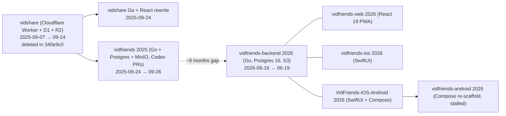

# Legacy audit: seven restarts of VidFriends

- **Status:** Final (historical record, 2026-10-03)
- **Owns:** what earlier attempts built, what they decided, and what we learned. This document is **not** a source of requirements. Requirements live in the [SRS](../requirements/SRS.md).
- **Evidence:** four detailed audit reports in [`audits/`](audits/), produced by reading the code at the tag `legacy-code-snapshot`. Paths inside those reports are relative to each original repository, which is now `legacy/<name>/` in the tag. Verbatim copies of every legacy planning document are in [`original-docs/`](original-docs/). All of them are **superseded** by the current document set.

## 1. Lineage

Agents wrote the 2026 generation: an "AI-agent org" whose commits are co-authored by "Paperclip" and whose tickets were tracked as `VID-*` in an external tracker. Codex agents wrote most of the 2025 `vidfriends` repo.

## 2. What each attempt contributes

| Attempt | Best contribution | Fatal problems | Detailed audit |
|---|---|---|---|
| vidshare Worker (deleted) | **The clearest product spec**, the owner's own README: a private FYP made only of videos friends sent you, a per-recipient share record (watched, saved, reaction), a 48-hour inbox window, Web Push, passkeys, and a multi-credential identity table | Unauthenticated `/share` endpoint; session cookie never expires; `'dev-secret'` JWT fallback; **VAPID private key committed to git** | [2025 §A](audits/2025-vidshare-vidfriends.md) |
| vidshare Go rewrite | Cookie sessions, per-user quota | Consent-free auto-friending, which enables spam; inverted CORS; yt-dlp argument injection; no tests | [2025 §A](audits/2025-vidshare-vidfriends.md) |
| vidfriends 2025 | Engineering practice: dependency injection (DI), versioned migrations, schema constraints, an async ingest worker separated from metadata lookup | **No authorization at all**; frontend and backend contract mismatch; fabricated UI data; docs claim features that do not exist | [2025 §B](audits/2025-vidshare-vidfriends.md) |
| vidfriends-backend 2026 | The broadest feature set: invite-only registration, hashed rotating refresh tokens, friends, send/inbox/unsend, threaded comments, reactions, admin console API, audit log, eviction and `keep_forever`, pHash dedup design, `SKIP LOCKED` job queue | Link import dead (1.8 µs timeout); WebSocket dead; push never sent; refresh token accepted as access token; prod compose ships dev JWT secret; no object-level authorization; dedup merge moves data across users | [backend](audits/2026-backend.md) |
| vidfriends-web 2026 | Two-step send flow, vertical snap feed, upload progress, admin console UX, server QR for pairing | Reads `{token}` while the server returns `access_token`; no friend management; broken E2E CI | [web+iOS §A](audits/2026-web-ios.md) |
| vidfriends-ios 2026 | Self-hosted pairing (URL + QR + health check), invite signup, share extension, inbox accept/reject, unsend, offline downloads, strong VoiceOver labels | Does not compile; decoding broken; saved server URL ignored at relaunch | [web+iOS §B](audits/2026-web-ios.md) |
| VidFriends-iOS-Android 2026 | Android feature reference (downloads with resume, notification channels, duplicate badge), iOS duplicate of the above | Android contract incompatible with the backend (no recipients); build broken | [mobile](audits/2026-mobile.md) |
| vidfriends-android 2026 | Module layering conventions | Stalled after about three tickets; ends in an unexplained revert (unique work tagged `legacy/vidfriends-android-2026/vid-503-fix`) | [mobile §3](audits/2026-mobile.md) |

**Verdict:** No attempt ever worked end to end. The plan was never authoritative. It was fragmented across `ROADMAP_TODO.md` (2025, mostly checked off with overstated claims), `VID-*` tickets in an unreachable tracker, and per-repo READMEs that contradicted their own code. The four audits list 29 doc-vs-code contradictions for the backend alone.

## 3. Product intent across eras (reconciled in the BRD/PRD)

| Theme | 2025 (owner-written Worker README) | 2026 (agent-written docs) | Resolution |
|---|---|---|---|
| Core promise | "builds users an fyp that only contains videos sent from friends" | "a unified place to find all of your shortform videos sent by your friends" | Same promise. Adopted. |
| Hosting | Cloudflare free tier at `vidfriends.app`; "privacy focused" | Self-hosted by a trusted friend; invite-only | [ADR-0005](../adr/0005-instance-model.md): single-tenant instance, self-hostable; the owner runs the first instance |
| Share model | Per-recipient link record | Per-recipient `received_videos` (backend, iOS); broadcast or no recipients (vidfriends 2025, Android) | Per-recipient shares ([ADR-0010](../adr/0010-share-centric-social-model.md)) |
| Feed | Inbox of received videos | Received FYP plus a global "all videos on server" feed | Received-only; **no global feed** |
| Engagement | One reaction or reply per share | Public-to-server likes, comments, reactions | Private to the share conversation ([ADR-0010](../adr/0010-share-centric-social-model.md)) |
| Media | Server-side download to R2 | yt-dlp download to S3/MinIO plus direct upload | Both, through a durable job queue ([ADR-0009](../adr/0009-media-ingestion-and-storage.md)) |
| Notifications | Web Push (payload-less) plus a pull inbox | ntfy/Gotify/FCM/APNs plus WebSocket (all dead) | In-app notifications plus Web Push, then Expo push ([ADR-0011](../adr/0011-notifications.md)) |
| Monetisation | "no ads, may eventually charge a subscription" | Open source (AGPL), no telemetry | No ads, no telemetry; licence is an open owner decision ([BRD](../requirements/BRD.md) OQ-2) |

## 4. Lessons (referenced by ID from the design docs)

| ID | Lesson | Evidence |
|---|---|---|
| L-01 | **One API contract, generated or shared types, contract-tested.** Every client drifted from its backend within days. | web/iOS §C2, mobile §4, 2025 §B.12 |
| L-02 | **Authorization comes from the session, never from client-supplied IDs, and is checked per object.** | 2025 §B.2; backend §5.1 |
| L-03 | **Green CI that builds what ships is a merge gate.** The iOS app never compiled; E2E jobs could not start; CI watched the wrong branch. | web/iOS §B7, backend §8.4 |
| L-04 | **"Done" means an executable end-to-end acceptance test passes.** Agent self-reports and checked-off TODOs were not trustworthy. | backend §11.2 #15, 2025 §B.10 |
| L-05 | **Background work goes through a durable queue** with bounded concurrency and retries. In-memory goroutines lost jobs and leaked disk. | backend §6.1, 2025 §B.6 |
| L-06 | **Secrets never live in git or default configs.** The server refuses to start with a weak or default secret. | 2025 §A.5 (VAPID key), backend §5.1 (dev JWT) |
| L-07 | **Typed durations and tested config defaults.** `30*60` became 1.8 µs. | backend §6.1 |
| L-08 | **Response-writer wrappers must preserve optional interfaces** (Hijacker, Flusher). More generally, test through the real router and middleware stack. | backend §4.4 |
| L-09 | **SSRF-safe URL handling before any fetch.** Use a host allowlist, never pass user input as CLI flags, and cap size and time. | 2025 §A.5, §B.5; backend §5.1 |
| L-10 | **Private object storage with signed URLs and HTTP Range support.** Never use public-read buckets or internal URLs in API responses. | 2025 §B.5, backend §6.2 |
| L-11 | **No fabricated UI data and no stubs shipped as features.** | 2025 §B.2, web/iOS §C3.11, mobile §7.2.9 |
| L-12 | **Consent-based friendship.** Sharing must never create friendships implicitly. | 2025 §A.7 |
| L-13 | **Store tokens hashed, rotate refresh tokens with reuse detection, make logout revoke, enforce account status on every request.** | backend §5.1 |
| L-14 | **Never edit an applied migration; migrations are forward-only and versioned.** | backend §3.1 (000009) |
| L-15 | **Nullable columns need nullable scan types, or NOT NULL with defaults.** Several 500s came from this. | 2025 §B.11 #12, backend §6.1 |
| L-16 | **Self-hosted reality:** LAN `http://` servers (Android cleartext policy), saved server URL applied at launch, a structured QR payload. | mobile §6, §7.1 |
| L-17 | **Single-flight token refresh, with a global "session expired" path back to login.** | web/iOS §B7.5, mobile §7.2.5 |
| L-18 | **Accessibility at the iOS VID-86 level on every platform**: real buttons, keyboard-operable sliders and dialogs, live regions. | web/iOS §A6, mobile §6 |
| L-19 | **Dedup must never move one user's data onto another user's object.** | backend §5.1, §6.5 |
| L-20 | **Rate limits keyed on the authenticated user or the real client IP** (trusted-proxy aware). Stricter limits on auth endpoints. | backend §5.1, 2025 §B.5 |

## 5. Security follow-ups that apply outside this repository

1. **VAPID key pair committed in `vidshare` history** (`8df7d4d:wrangler.toml`, now also reachable in this repo's history). Treat it as compromised. Never reuse it. If any Cloudflare Worker from that era is still deployed, the owner should rotate or remove it. Tracked as roadmap task M0-T3.
2. The 2026 backend's published compose used the public dev JWT secret. Any server that still runs that stack has forgeable admin tokens and should be shut down. Tracked as M0-T3.
3. External endpoints referenced by legacy code (`api-request.zem.systems/download`, `assets.vidfriends.app`, `paperclip.digifender.com`) are **not** dependencies of the new system.

## 6. Superseded documents

Every file under [`original-docs/`](original-docs/) is superseded. Notable mappings:

| Legacy document | Replaced by |
|---|---|
| `vidfriends-2025/ROADMAP_TODO.md`, `TODO.md`, `docs/FIRST_STEPS.md` | [ROADMAP](../ROADMAP.md) |
| `vidfriends-2025/docs/API_REFERENCE.md`, `vidfriends-backend-2026/docs/openapi.yaml` | [LLD §API](../design/LLD.md#3-http-api-contract) (and, once M1 lands, the generated OpenAPI) |
| `vidfriends-2025/docs/MANUAL_TEST_PLAN.md` | [SRS](../requirements/SRS.md) acceptance criteria and roadmap verification |
| `vidfriends-backend-2026/docs/backend-consolidation-decision.md` | [ADR-0002](../adr/0002-consolidate-repos-and-greenfield-reset.md), [ADR-0007](../adr/0007-backend-stack.md) |
| `vidfriends-backend-2026/docs/deployment.md`, `security-checklist.md` | [TDD §Deployment](../design/TDD.md#6-deployment-and-operations) |
| `vidfriends-backend-2026/docs/user-guide.md`, `faq.md`, `admin-setup.md` | [PRD](../requirements/PRD.md) and [FRD](../requirements/FRD.md). End-user docs are to be rewritten in M6. |
| `vidfriends-android-2026/ARCHITECTURE.md` | [HLD](../design/HLD.md), [ADR-0004](../adr/0004-mobile-expo.md) |
