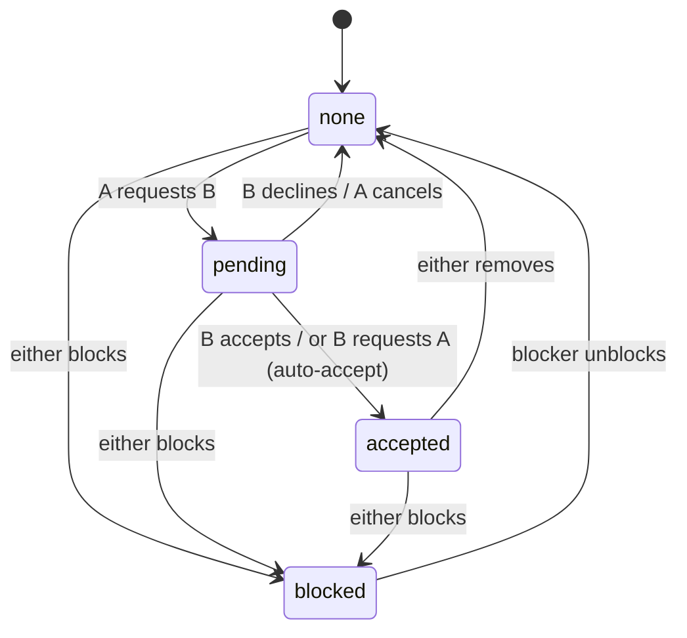
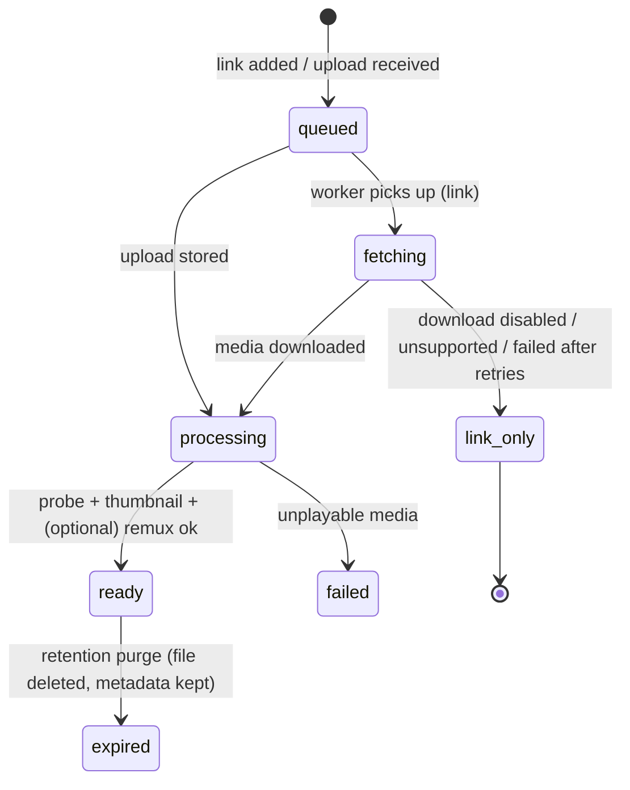

# FRD: Functional Requirements (behaviour)

- **Status:** Draft v1
- **Owns:** detailed behaviour, including workflows (`WF-*`), business rules (`BR-*`), permissions, state machines, validation, and alternate and failure paths.
- **Relationship to SRS:** the [SRS](SRS.md) holds the canonical, uniquely identified *requirements*. This document explains *how the behaviour works*. Each SRS requirement cites the `WF`/`BR` items it relies on. If the two conflict, fix the FRD to match the SRS, or raise an ADR.
- All rules apply identically to web and mobile clients, because the server enforces every rule (BR-GEN-1).

## 0. General rules

| ID | Rule |
|---|---|
| BR-GEN-1 | The server enforces every rule in this document. Client-side checks exist only for UX. |
| BR-GEN-2 | The acting user is always derived from the authenticated session. Request bodies never carry an "acting user id" ([L-02](../legacy/AUDIT.md#4-lessons-referenced-by-id-from-the-design-docs)). |
| BR-GEN-3 | When a resource exists but the caller may not see it, the response is **404**, not 403, so existence is not leaked. 403 is used only when the caller can see the resource but may not perform the action. |
| BR-GEN-4 | All timestamps are UTC (ISO-8601 in the API). Clients render them in local time. |
| BR-GEN-5 | Instance settings (§8) are read at request time. Changing one never requires a restart. |

## 1. Roles and permissions

| Action | Anonymous | Member | Admin |
|---|---|---|---|
| View instance info (name, signup mode) | ✓ | ✓ | ✓ |
| Register (with valid invite, or in open mode) | ✓ | – | – |
| Claim instance (bootstrap token, only while no admin exists) | ✓ | – | – |
| Friends, send, feed, engage, own profile | – | ✓ | ✓ |
| Create invites | – | if `members_can_invite` | ✓ |
| Admin console (users, settings, storage, audit) | – | – | ✓ |
| Read other members' shares or conversations | – | – | **✗** (not in the UI or API; see note) |

> **Note:** an operator with database or storage access can technically read everything. The product says this honestly in the onboarding copy ("Your server admin can technically access stored data. Only join servers run by people you trust."), as the legacy FAQ did.

## 2. Accounts and sessions

### WF-AUTH-1 Bootstrap (claim instance)
1. On startup, if no user has role `admin`, the server generates a one-time **setup token**. It logs the token at WARN level along with the `/setup` URL. The token is valid until it is used and is regenerated on each restart while unclaimed.
2. `/setup` asks for the token, the instance name, and the admin's username and display name, then registers a passkey ([ADR-0018](../adr/0018-passkey-only-sign-in.md)). On success the account is created as `admin`, the token is invalidated and the admin is signed in.
3. **Failure paths:** a wrong token returns 401 and counts toward the auth rate limit. If an admin already exists, `/setup` returns 404.

### WF-AUTH-2 Register
- **Preconditions:** `signup_mode = invite_only` plus a valid invite code, **or** `signup_mode = open`.
- **Inputs:** username, optional display name, invite code, and a passkey registration (WF-AUTH-4).
- **Steps:**
  1. Validate the inputs (BR-ACCT-1..3).
  2. Lock the invite row (BR-INV-2).
  3. Create the user.
  4. Consume one use of the invite.
  5. If the invite has `auto_friend = true`, create an `accepted` friendship with the invite creator.
  6. Store the passkey and create a session, which signs the user in.
- **Failures:**
  - Invalid, expired, revoked or exhausted invite: 400 `invite_invalid`. The response gives one generic reason and never says which condition failed.
  - Username taken: 409 `username_taken`.
  - Validation errors: 400 with per-field messages.

### WF-AUTH-3 Sign in / log out
- **Sign in** uses a passkey; no username is typed ([ADR-0018](../adr/0018-passkey-only-sign-in.md)).
  1. The client asks for sign-in options; the server returns a single-use challenge (5 minutes).
  2. The browser shows this server's passkeys on the device; the member confirms with their screen lock or biometrics.
  3. The server verifies the assertion and its counter against the stored credential. Unknown or invalid credentials get the generic 401 `invalid_credentials`. A `suspended` account gets 403 `account_suspended`, but only after the assertion verified.
  4. A session is created ([ADR-0008](../adr/0008-authentication-sessions.md)): the web client gets an httpOnly cookie. The mobile app signs in through the browser hand-off (WF-AUTH-5) and receives a bearer token.
- **Logout** revokes the current session server-side. "Log out everywhere" revokes all of the user's sessions.

### WF-AUTH-4 Register a passkey
Used by setup, join, recovery and "add a passkey".
1. The server returns registration options with a single-use challenge (5 minutes), the account's user handle, and the existing credential ids to exclude. It requires a discoverable credential and user verification.
2. The browser creates the passkey; the client sends the attestation with an optional name (default: the device or password manager name the browser reports, else "Passkey").
3. The server verifies origin, relying party (the `PUBLIC_URL` host) and challenge, then stores the credential id, public key, counter and transports.

### WF-AUTH-5 Mobile sign-in by browser hand-off
1. The app creates a random `state` and a PKCE verifier, and opens `PUBLIC_URL/app-auth?mode=signin|join&state=…&code_challenge=…` (S256) in the system's secure browser sheet. For a join link, the invite code is passed too.
2. The page runs WF-AUTH-3 or WF-AUTH-2 in the browser.
3. The server issues a one-time code (60 seconds, stored as a hash, bound to the challenge) and redirects only to `vidfriends://auth?code=…&state=…`.
4. The app checks `state` and exchanges code and verifier for a bearer session (`client: "mobile"`). A wrong verifier, a reused or expired code gets 400 `code_invalid`.
### Session rules

| ID | Rule |
|---|---|
| BR-SES-1 | A session expires after **30 days of inactivity** (sliding) and, in any case, **180 days** after creation. These are proposed defaults and can be configured per instance. |
| BR-SES-2 | All sessions of a user are revoked on: suspension, role change, account deletion and recovery (WF-ADM-4). Removing a passkey revokes the sessions that passkey created. |
| BR-SES-3 | Every authenticated request re-checks session validity and account status, so a suspension takes effect on the next request. |

### Account rules

| ID | Rule |
|---|---|
| BR-ACCT-1 | **Username:** 3–30 characters from `[a-z0-9_.]`, must start with a letter or digit, and is stored lower-case. Uniqueness is case-insensitive. Usernames cannot be changed in v1. |
| BR-ACCT-2 | **Passkeys:** the only credential ([ADR-0018](../adr/0018-passkey-only-sign-in.md)); there are no passwords. A member holds 1–10 passkeys with names of up to 50 characters, and cannot remove the last one. Sign-in, passkey removal and account deletion require user verification. |
| BR-ACCT-3 | **Display name:** 0–50 characters, trimmed. **Avatar:** an image upload of at most 2 MB, re-encoded server-side to a 256×256 WebP. |
| BR-ACCT-4 | No email address is collected in v1 (BO-5). Recovery after losing every passkey is admin-assisted (WF-ADM-4). |

### WF-ACCT-1 Edit profile
A member can change their display name and avatar. Changes are visible to their friends.

### WF-ACCT-2 Manage passkeys
Settings → Passkeys lists the member's passkeys with name, creation and last-use time. A member can add one (WF-AUTH-4), rename one, or remove one after confirming with a passkey (WF-AUTH-3 assertion within the last 5 minutes). The last passkey cannot be removed (409 `last_passkey`). Removing a passkey revokes the sessions it created.

### WF-ACCT-3 Delete account
- **Precondition:** the user confirms with a passkey (an assertion within the last 5 minutes). Rate limit: 3 attempts per hour.
- **Effect** (hard delete, executed in a transaction plus asynchronous media cleanup):
  1. Delete the user's sessions, push subscriptions, invites, friendships and blocks.
  2. Delete the shares they **sent** and the shares they **received**, which cascades to the reactions and replies in those conversations.
  3. Delete their notifications and data exports.
  4. Media with no remaining shares becomes eligible for garbage collection (BR-MED-5).
  5. Write an audit entry that records only the deleted user id.
- **Last admin:** if the user is the only admin, deletion is refused with 409 `last_admin` until another admin exists.

### WF-ACCT-4 Export my data
- **Request:** a member asks for an export, optionally including media. At most one export is in progress per member, and at most 3 can be requested per 24 hours (429 `rate_limited`).
- **Build** (background job): a ZIP with `README.txt`, `profile.json`, `friends.json` (friends, requests in and out, blocks), `received.json` and `sent.json` (each share with its video's title, original link and platform, the note, delivery and watch times, saved and hidden for received shares, the reaction and the whole conversation), `videos.json` (videos the member added), `security.json` (the member's own audit entries: action, time, network address) and the avatar. With media, the stored files of videos the member added are included under `media/` while their total stays under 4 GiB; beyond that the README says which were left out.
- **Contents rule:** the export holds only what the member could already see in the app. Other members appear by username and display name; their replies are included only inside the member's own conversations.
- **Download:** a short-lived signed link, available for 7 days after the export is ready. Then the file is deleted and the export shows as expired.
- **Failure:** the export shows as failed and no partial file is kept. A build still unfinished after 2 hours (for example because the worker stopped) is marked failed by the cleanup job, so the member can request again.
- Deleting the account deletes its exports (WF-ACCT-3). Requests are audited (`account.export_requested`).

## 3. Invites

| ID | Rule |
|---|---|
| BR-INV-1 | An invite has a code (256-bit random, URL-safe), creator, `max_uses` (default 1, maximum 50), `uses`, `expires_at` (default 7 days, maximum 90 days), `auto_friend` (default true), and `revoked_at`. |
| BR-INV-2 | Consumption locks the row (`SELECT … FOR UPDATE`), so concurrent registrations can never exceed `max_uses` ([legacy good pattern](../legacy/audits/2026-backend.md)). |
| BR-INV-3 | Creators can list and revoke their own invites. Admins can list and revoke all invites. |
| BR-INV-4 | The shareable form of an invite is the **join URL** `https://<instance>/join/<code>`. The QR code encodes the same URL ([ADR-0013](../adr/0013-instance-pairing-and-join-links.md)). |
| BR-INV-5 | Codes are stored hashed (SHA-256), so the plaintext code is shown only once, at creation. |

## 4. Friends

| ID | Rule |
|---|---|
| BR-FRND-1 | Friendship is consent-based. Nothing else creates a friendship except accept, mutual request, or an `auto_friend` invite redemption ([L-12](../legacy/AUDIT.md#4-lessons-referenced-by-id-from-the-design-docs)). |
| BR-FRND-2 | A pair has at most one relationship row, regardless of direction. Self-relationships are impossible. |
| BR-FRND-3 | If A requests B while B→A is pending, the request is accepted immediately. |
| BR-FRND-4 | Decline deletes the request silently: the requester sees it disappear and is not told it was declined. The requester may request again after **7 days** (cooldown stored on the pair). |
| BR-FRND-5 | A block is directional (`blocked_by`). It removes any friendship or pending request. The blocked user cannot request, find (search), or send to the blocker. Existing shares between the two disappear from the blocker's views and are deleted for both sides. |
| BR-FRND-6 | Only the blocker can unblock. Unblocking returns the pair to `none`; it does not restore the friendship. |
| BR-FRND-7 | A member can send at most **30 friend requests per 24 hours** (spam control). |
| BR-FRND-8 | User search is by username prefix and display-name substring. It requires at least 2 characters and returns at most 20 results. It excludes the caller, users who blocked the caller, and suspended users. Results show only username, display name, avatar and relationship state. |

## 5. Videos (media items)

A **Video** is an immutable media record on the instance. It is created when a member adds a link or uploads a file. Videos are never browsable on their own; they are visible only through shares (BR-SHR-6).

### WF-VID-1 Add by link
1. Validate the URL (BR-MED-1).
2. Normalise it (strip tracking parameters, resolve known short-link hosts only via an allowlisted HEAD request).
3. If a `ready` or in-progress Video with the same normalised URL already exists on the instance, reuse it (BR-MED-4).
4. Otherwise create a Video in state `queued` and enqueue a `video.fetch` job.
5. The API returns immediately with the Video id and status. Sending does not need to wait (WF-SHR-1).

### WF-VID-2 Upload
1. The client uploads via the resumable/direct upload flow ([LLD §4](../design/LLD.md#4-media-pipeline)).
2. The server checks the size limit and the user quota *before* accepting the bytes, then checks the media type by content sniffing.
3. The server computes SHA-256. If a Video with the same hash exists, it is reused.
4. Otherwise the server enqueues `video.process`.

### Media rules

| ID | Rule |
|---|---|
| BR-MED-1 | Links must be `https` (or `http`, upgraded where possible), at most 2,048 characters, with a host on the instance's **platform allowlist** (default: YouTube incl. Shorts, TikTok, Instagram, Facebook, X/Twitter, Reddit, Vimeo). Hosts are suffix-matched on registrable domain. Links to IP literals, `localhost`, private ranges or non-allowlisted hosts are rejected with 400 `url_not_allowed` ([L-09](../legacy/AUDIT.md#4-lessons-referenced-by-id-from-the-design-docs)). |
| BR-MED-2 | Limits (instance settings): `max_media_bytes` default 200 MB, `max_duration_seconds` default 600, `per_user_quota_bytes` default 5 GB (null means unlimited), `instance_storage_cap_bytes` default unlimited. A fetch that exceeds a limit ends in `link_only` (for links) or is rejected with 413 (for uploads). |
| BR-MED-3 | Fetch jobs retry up to 3 times with exponential backoff (1 m, 5 m, 30 m). After that the Video becomes `link_only` with `failure_reason`. Shares still work, as a link-out card. |
| BR-MED-4 | **Dedup** is by exact normalised URL or exact SHA-256 only, and only reuses the *media*. It never merges shares, reactions or replies across users ([L-19](../legacy/AUDIT.md#4-lessons-referenced-by-id-from-the-design-docs)). Perceptual hashing is out of scope for v1. |
| BR-MED-5 | **Retention** (instance setting `retention_days`, default 90; 0 means keep forever): the media file is deleted when *no share references it*, **or** when every referencing share is either watched more than `retention_days` ago or created more than `retention_days` ago and still unwatched, **and** no referencing share is saved. Metadata is kept and the state becomes `expired` (the share shows "expired, open original"). A daily job enforces this. |
| BR-MED-6 | Storage is attributed to the member who first added the Video, for quota purposes. Bytes are released when the file is purged. |
| BR-MED-7 | Stored media is private. Clients get short-lived signed URLs (≤ 15 min) via the API, after an authorization check (BR-SHR-6). Range requests must work so seeking works on every player ([L-10](../legacy/AUDIT.md#4-lessons-referenced-by-id-from-the-design-docs)). |
| BR-MED-8 | Metadata kept: title (provider title or uploader-entered, at most 200 characters), provider name, uploader/author handle (if supplied by the provider), duration, width and height, thumbnail (stored, never hotlinked), normalised URL, SHA-256. |
| BR-MED-9 | Instance setting `link_download_enabled` (default **true**). When it is false, links skip fetching and become `link_only` with metadata (title and thumbnail) where a fetch is possible. This is the conservative legal mode for BRD OQ-1. |

## 6. Shares (sending)

### WF-SHR-1 Send
- **Inputs:** `video_id`, `recipient_ids[]` (1–20), optional `note` (at most 500 characters), and `idempotency_key`.
- **Preconditions:** the caller added the Video **or** received a share of it (re-sharing is allowed). Every recipient is an accepted friend who is not blocked in either direction.
- **Effect:**
  1. One **Share** row is created per recipient, in a single transaction.
  2. Results are returned per recipient: `sent`, `already_sent` (same sender, recipient and video; not duplicated), or `not_allowed`.
  3. Notifications: when the Video is `ready` or `link_only`, recipients are notified immediately. While it is `queued`, `fetching` or `processing`, the share is delivered to the recipient's feed once the Video becomes playable or link-only, and notification happens then. The sender sees "processing" in Sent.
- **Idempotency:** retrying with the same `idempotency_key` within 24 h returns the original result.

### WF-SHR-2 Unsend
The sender may delete a share while `watched_at` is null. The recipient's notification for it is deleted too. After the share is watched, unsend returns 409 `already_watched`.

### Share rules

| ID | Rule |
|---|---|
| BR-SHR-1 | A Share belongs to exactly one sender and one recipient and references one Video. |
| BR-SHR-2 | Recipient state: `watched_at` (null or a time), `progress_seconds`, `saved` (bool), `hidden` (bool, meaning "remove from my inbox"), and `reaction` (null or an emoji). |
| BR-SHR-3 | **Watched** is set once, when playback reaches ≥ 50% of the duration or ≥ 10 s (whichever comes first), or when the recipient opens the original link from a link-only card. It is never set by scrolling past ([lesson from web audit A7#3](../legacy/audits/2026-web-ios.md)). |
| BR-SHR-4 | A sender sees, per share: status (`processing` / `delivered` / `watched` + time), reaction, reply count and last reply. A sender does **not** see `saved` or `hidden`. |
| BR-SHR-5 | Shares involving a suspended user remain stored but are hidden from the other party's views until the suspension is lifted. |
| BR-SHR-6 | **Visibility:** a member can see a Video only through a Share where they are the sender or the recipient, or through the Video they added themselves. Every media URL, thumbnail and metadata request is checked against this rule (NFR-SEC-01). |

## 7. Feed, inbox, history

| ID | View | Contents and ordering |
|---|---|---|
| BR-FEED-1 | **Feed** (default screen) | Shares received, not hidden, Video playable or link-only, **unwatched first, oldest unwatched first**. When the user reaches the end of unwatched items, the feed shows "You're all caught up", then offers to continue with recently watched shares (newest first). |
| BR-FEED-2 | **Inbox** (list) | Received shares that are unwatched, **or** saved, **or** watched in the last 48 h, newest first. Shows sender, note, thumbnail and state ([legacy 48 h rule](../legacy/audits/2025-vidshare-vidfriends.md)). |
| BR-FEED-3 | **Saved** | Received shares with `saved = true`, newest saved first. |
| BR-FEED-4 | **History** | Received shares with `watched_at` set, newest watched first. Filterable by sender and by title substring. |
| BR-FEED-5 | **Sent** | Shares sent by the caller, grouped by Video and send time, showing per-recipient state (BR-SHR-4). |
| BR-FEED-6 | Pagination | Cursor-based keyset pagination on `(sort_key, id)` at full timestamp precision. Page size is 20 by default and 50 at most ([legacy cursor bug](../legacy/audits/2026-backend.md)). |
| BR-FEED-7 | Duplicate awareness | If the same Video was shared to the recipient by several friends, the feed shows **one** item with "also sent by …". Watching it marks all of those shares watched. Each conversation remains separate. |

**Playback UX rules** (client): vertical full-screen swipe; only the active item plays; the next item is preloaded; web autoplay starts muted with a persistent unmute toggle that is remembered for the session; respect `prefers-reduced-motion` (no autoplay; tap to play).

## 8. Engagement (share conversation)

| ID | Rule |
|---|---|
| BR-ENG-1 | Each Share has a private conversation visible only to its sender and recipient. |
| BR-ENG-2 | The **recipient** can set one reaction from a fixed set (👍 ❤️ 😂 😮 😢 🔥), replace it or clear it. The sender is notified when it is first set or changed. |
| BR-ENG-3 | **Replies:** either participant can post text replies of 1–1,000 characters, shown in chronological order. The author can delete a reply, which leaves a "reply deleted" placeholder. No editing in v1. |
| BR-ENG-4 | Each reply notifies the other participant. Replies are rate-limited to 60 per user per 10 min. |
| BR-ENG-5 | If the share is unsent or deleted, its conversation is deleted with it. |

## 9. Notifications

| ID | Rule |
|---|---|
| BR-NOT-1 | **Types:** `share_received`, `reaction_received`, `reply_received`, `friend_request_received`, `friend_request_accepted`, `share_watched` (in-app only by default). |
| BR-NOT-2 | Every notification is stored in-app first, then fanned out to the user's push channels according to per-type preferences (default: all push-enabled except `share_watched`). |
| BR-NOT-3 | Push payloads contain no content beyond a generic title and an opaque id, for example "New video from Sam". The client fetches details after authenticating. Users can choose "private previews" so pushes do not show the sender name. |
| BR-NOT-4 | Coalescing: several `share_received` events from the same sender within 2 minutes become one push ("Sam sent you 3 videos"). |
| BR-NOT-5 | In-app notifications are kept for 90 days, then purged. Reading the referenced item marks the notification read. |
| BR-NOT-6 | A push endpoint that returns *gone* (Web Push 404/410, Expo `DeviceNotRegistered`) is deleted. |
| BR-NOT-7 | **Realtime ([ADR-0019](../adr/0019-realtime-invalidation-over-sse.md)):** when a notification is created for a member, or their notifications are marked read, each of their open streams gets an event naming only the change (`notification` with its type and share id, or `notifications_read`). Clients refetch the affected lists through the API. A member has at most 5 open streams; streams re-check the session every 25 s and end after 30 minutes, on sign-out, revocation or suspension, and clients reconnect. |
| BR-NOT-8 | **ntfy and Gotify ([ADR-0020](../adr/0020-ntfy-and-gotify-push-channels.md)):** a member may add up to 5 such targets. ntfy: a topic URL and an optional access token; Gotify: a server URL and an application token. The push carries the BR-NOT-3 title and a link to the instance. A target answering 401, 403 or 404 is deleted (BR-NOT-6). A test push is limited to 5 per 10 minutes per member. |

## 10. Administration

| Workflow | Behaviour |
|---|---|
| WF-ADM-1 Users | List and search users with status, role, created and last-active dates, and storage used. Actions: suspend, unsuspend, promote, demote (never the last admin), delete (WF-ACCT-3 semantics), generate a recovery link (WF-ADM-4). |
| WF-ADM-2 Invites | Create (with `max_uses`, expiry and `auto_friend`), list, revoke. Show the join URL and QR code. |
| WF-ADM-3 Settings | Settings: `instance_name`, `signup_mode` (`invite_only`\|`open`, default `invite_only`), `members_can_invite` (default true), `link_download_enabled`, `platform_allowlist`, `max_media_bytes`, `max_duration_seconds`, `per_user_quota_bytes`, `instance_storage_cap_bytes`, `retention_days`, session lifetimes. Every change is audited. |
| WF-ADM-4 Recovery link | The admin generates a single-use recovery link valid for 24 h and gives it to the member out of band. Opening it registers a new passkey (WF-AUTH-4), then **removes the member's other passkeys and revokes all their sessions** (the usual cause is a lost device). For a locked-out admin, the operator runs `node dist/main.js recovery-link <username>` in the server container, which prints such a link to the terminal and writes an audit entry. |
| WF-ADM-5 Storage | Shows total bytes, bytes per user, counts by video state, and the next retention run. "Run retention now" enqueues the job. |
| WF-ADM-6 Audit log | Append-only. Records admin actions, sign-ins (success and failure), session revocations, account deletions, setting changes, invite creation and use. Filterable by actor, action and date. Retained for 365 days. IP addresses come from the trusted-proxy-aware client IP (NFR-SEC-06). |

| ID | Rule |
|---|---|
| BR-ADM-1 | Admins cannot read conversations, notes or another member's feed through any API. Admin user listings show only counts. |
| BR-ADM-2 | When a member is suspended (BR-SES-2, BR-SHR-5), they cannot log in. Their shares are hidden from others but kept until they are unsuspended or deleted. |

## 11. Instance pairing (clients)

| ID | Rule |
|---|---|
| WF-PAIR-1 | The mobile app's first screen offers: scan QR, or paste a join or instance URL. There is no default instance ([ADR-0014](../adr/0014-self-host-only-no-public-instance.md)). The app calls `GET /api/v1/instance` to verify that the server is VidFriends, has a compatible API major version, and to read its name and signup mode. Only then does it persist the base URL ([ADR-0013](../adr/0013-instance-pairing-and-join-links.md)). |
| WF-PAIR-2 | The app persists the base URL and applies it on every launch ([L-16](../legacy/AUDIT.md#4-lessons-referenced-by-id-from-the-design-docs)). The user can switch servers only by signing out. |
| WF-PAIR-3 | Only `https://` base URLs are accepted ([ADR-0018](../adr/0018-passkey-only-sign-in.md): passkeys need HTTPS on a domain name). A plain `http://` link is refused with a message that the server must use HTTPS. Exception: the device's own loopback address (`localhost`, `127.0.0.1`, `::1`), which browsers also treat as secure, for development and the emulator E2E. The Android build permits cleartext traffic only to loopback. |
| WF-PAIR-4 | The web client is served by the instance itself, so it never asks for a server. |
